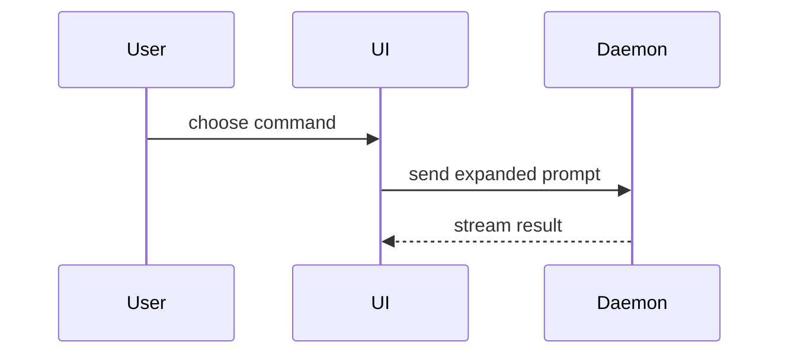

Output language: Portuguese. The PR title is the exception: write it in English.

This skill defines how to open, describe, and prepare a pull request in this repository.

## Before opening

Open the PR when:

- the branch is on the remote;
- a primary issue exists, or the docs/process exception is recorded;
- the scope is complete;
- the applicable validations have run;
- you have reviewed your own diff;
- the description and evidence are ready.

Use Draft when you need to validate an approach, discuss structure, or anticipate risk. A Draft is not ready for approval or merge.

When a Draft is ready:

1. close the pending items;
2. review the diff;
3. update the description;
4. mark it ready for review;
5. request a reviewer.

## Title

Format:

```text
type(scope): description
```

- `type` and `description` are in English.
- `scope` is required and names the affected area: `auth`, `orders`, `pr`, `docs`.
- Squash merge uses the PR title. Keep it up to date until the merge.

| Type       | Use                                                      |
| ---------- | -------------------------------------------------------- |
| `feat`     | New functionality                                        |
| `fix`      | Behavior fix                                             |
| `docs`     | Documentation                                            |
| `refactor` | Reorganization without an intentional behavior change    |
| `perf`     | Performance improvement                                  |
| `test`     | Tests                                                    |
| `style`    | Formatting or style, with no behavior change             |
| `build`    | Build or dependencies                                    |
| `ci`       | CI configuration                                         |
| `chore`    | Maintenance                                              |
| `revert`   | Reversal of a previous change                            |

Examples:

```text
feat(auth): add corporate email validation
fix(orders): reject duplicate order
docs(pr): rewrite pull request skill
refactor(auth): extract password field
chore(deps): update express to 5.1
```

## Language

In English:

- code;
- technical file and directory names;
- branches and commits;
- PR titles;
- variables, functions, classes, and routes;
- tables and fields.

In Portuguese:

- PR descriptions and comments;
- review comments;
- messages shown to end users, such as API errors and UI text;
- project documentation: `AGENTS.md`, `CODING_STANDARDS.md`, `SETUP.md`, and `docs/`.

## Related issue

Every PR that changes code or behavior must indicate a primary issue:

```markdown
## Issue relacionada

Issue principal: #123
```

For documentation or process changes, when there is no issue, write `Nenhuma` and justify it in one line:

```markdown
Issue principal: Nenhuma — mudança de processo, sem issue correspondente.
```

An issue may have several PRs when the delivery is split into parts. Related issues are optional:

```markdown
Issues relacionadas:

- Nenhuma; ou
- #124
```

Do not use `Closes #123`. Closing is manual: after the merge, update the issue and the Project with `gh issue close` and a comment containing the PR link.

## Scope and size

Each PR must represent a specific, coherent change.

Avoid mixing:

- different features;
- unrelated fixes;
- refactoring with a behavior change;
- unrelated dependencies;
- documentation on another subject.

There is no mandatory line limit. Evaluate clarity and cohesion. If the PR has multiple goals or is hard to summarize, split it into stacked PRs.

## Before requesting review

Review your own work:

```bash
git status
git diff
```

Also review the diff on GitHub. Check:

- files related to the task and no accidental files;
- no logs, temporary comments, or dead code;
- no credentials, tokens, or personal data;
- English names;
- updated documentation;
- acceptance criteria met;
- validations run.

## Expected validations

Backend:

- type-check;
- relevant tests;
- lint and formatting when available;
- local endpoint execution with valid and invalid input;
- migration and rollback when applicable.

Documentation and process:

- full read of the file;
- links and Markdown rendering;
- consistency with `AGENTS.md` and `CODING_STANDARDS.md`.

The absence of an automated test does not remove the need for manual validation. Exceptions to `CODING_STANDARDS.md` need a justification in the PR.

## PR body template

```markdown
## Resumo

<menor visão que explica a mudança: diff, árvore, call tree, mermaid ou pseudocódigo>
<1–3 frases: o que mudou e por quê>

## Issue relacionada

Issue principal: #N <!-- ou "Nenhuma" para docs/processo, com justificativa -->
Empilhado sobre: #N <!-- remover quando a base for main -->

## Escopo não incluído

- Nenhum; ou
-

## Como validar

1.
2.

## Evidências

- **Antes:**
  **Depois:**

## Impactos, dependências e limitações

- Nenhum; ou
-

## Risco de merge

**Door:** two-way — <por quê>
**Raio de impacto:** <uma palavra/frase>

## Checklist do autor

- [ ] Revisei o diff e não há arquivos acidentais.
- [ ] O PR está limitado ao escopo declarado no Resumo.
- [ ] Validações aplicáveis executadas (type-check, testes, lint).
- [ ] Sem credenciais, dados sensíveis ou código temporário.
- [ ] Descrição, evidências e documentação estão atualizadas.
```

## How to fill in

Skip all preambles and keep prose brief. Use the domain language from `GLOSSARY.md` when it exists.

### Resumo

Pick the smallest view that makes the key point clear.

- Show logic or an algorithm as pseudocode:

```text
on(save)
  if content is unchanged
    return cached result
  write new content
  return fresh result
```

- Show runtime control flow as a call tree:

```text
submitForm
  createSession
    persistPrompt
    launchAgent
  navigateToSession
```

- Show file responsibility or a broad refactor as a shallow file tree:

```text
src/
├── commands/       # parses user actions
├── sessions/       # owns session state
└── transport/      # sends API requests
```

- Show component interaction, control flow, or data flow with Mermaid:



- Use `diff` when the point is what changes and the surrounding shape already exists. Match the diff shape to the topic.

For a file-layout change:

```diff
 src/
 ├── commands/
+│   └── show-me.ts       # expands the slash command
 ├── sessions/
-└── transport.ts
+└── transport/
+    ├── client.ts
+    └── stream.ts
```

For a call-tree or call-stack change:

```diff
 submitForm
   createSession
     persistPrompt
+    expandSkillMention
     launchAgent
-  navigateToSession
+  navigateToSession
+    subscribeToEvents
```

For a state or control-flow change:

```diff
 on(save)
-  write content
+  if content is unchanged
+    return cached result
+  write new content
+  invalidate cache
```

- Show the whole block when most of it is new, when omitted context would hide ownership or order, or when the user needs a copyable target shape:

```ts
function expandSkill(command: string): string {
  const skillName = command.slice(1);
  return `use the ${skillName} skill`;
}
```

#### Guidance

Place each visual next to the short text it supports. Keep only the calls, files, props, states, and boundaries needed to answer the current question or the options to resolve the current discussion point.

You may use one of these, you may use several, it is unlikely you will use all of them. Use your judgement and don't overwhelm the reviewer.

If the change is not visual — configuration, dependency, text — use a short bullet list instead of a diagram.

### Issue relacionada

Provide the primary issue and, when applicable, the base issue:

```markdown
Issue principal: #123
Empilhado sobre: #122
```

Remove the `Empilhado sobre` line when the base is `main`. For the docs/process exception, use `Issue principal: Nenhuma` and justify it.

### Escopo não incluído

Record what is out when there is a risk of doubt. This prevents the reviewer from asking for work that belongs to another issue.

```markdown
## Escopo não incluído

- autenticação real;
- recuperação de senha.
```

If there are no relevant exclusions, write `Nenhum`.

### Como validar

Provide reproducible steps. Do not just describe what you did: write what the reviewer must run.

Backend example:

```markdown
1. Suba a API e o banco local.
2. Envie `POST /api/auth/login` com credenciais válidas e confirme `200`.
3. Envie uma senha inválida e confirme `401`.
4. Confirme que nenhum token aparece no log.
```

Documentation example:

```markdown
1. Leia o documento completo.
2. Verifique os links internos.
3. Confirme a coerência com `AGENTS.md` e `CODING_STANDARDS.md`.
```

Migration example:

```markdown
1. Aplique a migration no banco local.
2. Confirme o schema esperado.
3. Execute o rollback e confirme que o schema anterior volta.
```

### Evidências

Concrete evidence that the change works. Show a before and after.

Screenshots are S-tier when the environment is set up for it and the change is visual.

Execution-based evidence is A-tier. Test results, console output, request and response. Show the exact test that now fails and passes, using pseudocode when needed.

For backend, include:

- request and response;
- output of the relevant tests;
- logs or the changed contract, when applicable;
- migration applied and rolled back, when applicable.

Do not include credentials, tokens, real personal data, or restricted information.

### Impactos, dependências e limitações

Report:

- contract change between teams;
- migration dependency;
- simulated functionality;
- behavior not implemented yet;
- impact on another flow;
- need for a change in another repository;
- provisional MVP decision.

If none exist, write `Nenhum impacto, dependência ou limitação conhecida`.

Example:

```markdown
O endpoint retorna dados simulados. A integração com o serviço de pedidos
será feita em outra issue após a definição do contrato.
```

### Risco de merge

Describe whether it's a one-way (hard to reverse) or two-way (easy to reverse) door. Keep `Door`, `one-way`, and `two-way` in English: they are canonical software terms. You can walk back through two-way doors, but not one-way doors. A PR that is cheap to roll back is lower risk. Changes that involve destructive actions or hard-to-reverse decisions are one-way doors.

In short: `one-way` means hard to reverse; `two-way` means easy to reverse.

The blast radius is the potential impact or scope of the changes introduced by this PR. Consider all possibilities. Examples are layout shift, breakages for consumers, mobile responsiveness, etc.

Examples for this repository:

```text
Door: two-way — markdown isolado, reversível com um revert.
Raio de impacto: docs only — não altera runtime, build, CI ou dependências.
```

```text
Door: one-way — migration destrutiva, exige backup e plano de rollback.
Raio de impacto: banco e contrato da API — afeta todos os consumidores.
```

### Checklist do autor

Only check `[x]` after verifying the item. Never pre-check items.

## Stacked pull requests

This repository uses `gh stack`. Before describing the PR, check the stack:

```bash
gh stack view
gh pr view <number> --json baseRefName
```

If the base is not `main`, add to the body:

```markdown
Empilhado sobre: #N
```

Rules:

- merge from the bottom up; never merge a PR before its base;
- after the base lands, run `gh stack sync` and, if needed, `gh stack rebase`;
- `gh stack submit` updates the base of the remaining PRs;
- confirm the base with `gh pr view`;
- without `gh stack`, change it manually with `gh pr edit <number> --base main`.

## Review and merge

The author does not approve their own PR. A PR may have more than one reviewer. An API contract change involves the consumers.

Review comments are written in Portuguese and use tags:

| Tag            | Use                                                |
| -------------- | -------------------------------------------------- |
| `[BLOCKER]`    | Must be fixed before the merge.                    |
| `[SUGGESTION]` | Recommended improvement.                           |
| `[QUESTION]`   | Question needed to understand the decision.        |
| `[NIT]`        | Small naming or readability adjustment.            |
| `[PRAISE]`     | Recognition of a good decision.                    |

Comment on the change, not the person.

Merge only when:

- the PR is not a Draft;
- another person has approved it;
- there are no pending comments;
- there is no conflict with the base;
- the applicable validations are green;
- the documentation is up to date.

Use **squash and merge**, keeping the `type(scope): description` title.

After the merge:

1. delete the branch;
2. update the issue and the Project;
3. record the PR link in the issue;
4. open new issues for remaining work.

## Example

````markdown
Título: feat(orders): reject duplicate order

## Resumo

```text
POST /orders
  validate(body)
  findActiveByCustomerAndProduct(customerId, productId)
    -> existing order? 409 order_already_exists
  createOrder(...)
    -> 201 order
```

Rejeita pedidos duplicados ativos para o mesmo cliente e produto. Antes, a segunda requisição criava um novo pedido.

## Issue relacionada

Issue principal: #34

## Escopo não incluído

- cancelamento de pedido;
- expiração automática de pedidos ativos.

## Como validar

1. Suba a API e o banco local.
2. Envie `POST /orders` com um pedido válido e confirme `201`.
3. Repita o mesmo payload e confirme `409` com `error.code = order_already_exists`.
4. Cancele o primeiro pedido e repita; confirme que um novo pedido é criado.

## Evidências

- **Antes:** `POST /orders` repetido retornava `201` e criava dois pedidos.
  **Depois:** retorna `409 order_already_exists`; o teste `orders.test.ts` passa.

## Impactos, dependências e limitações

- O Frontend precisa tratar `409` e exibir a mensagem de pedido duplicado.
- A regra considera apenas pedidos com status `active`.

## Risco de merge

**Door:** two-way — a mudança é reversível com revert; nenhuma migration.

**Raio de impacto:** contrato da API — um novo erro `409` passa a ser retornado.

## Checklist do autor

- [x] Revisei o diff e não há arquivos acidentais.
- [x] O PR está limitado ao escopo declarado no Resumo.
- [x] Type-check e testes relevantes passam.
- [x] Sem credenciais, dados sensíveis ou código temporário.
- [x] Descrição, evidências e documentação estão atualizadas.
````
