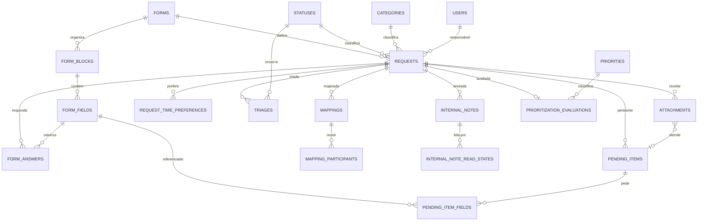
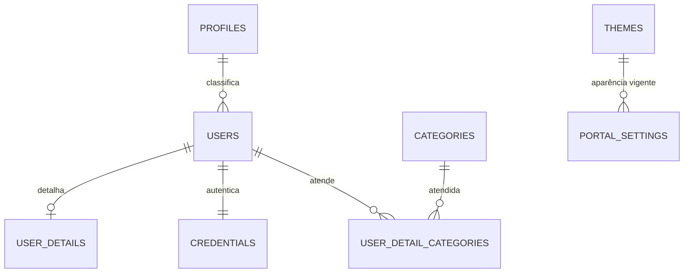
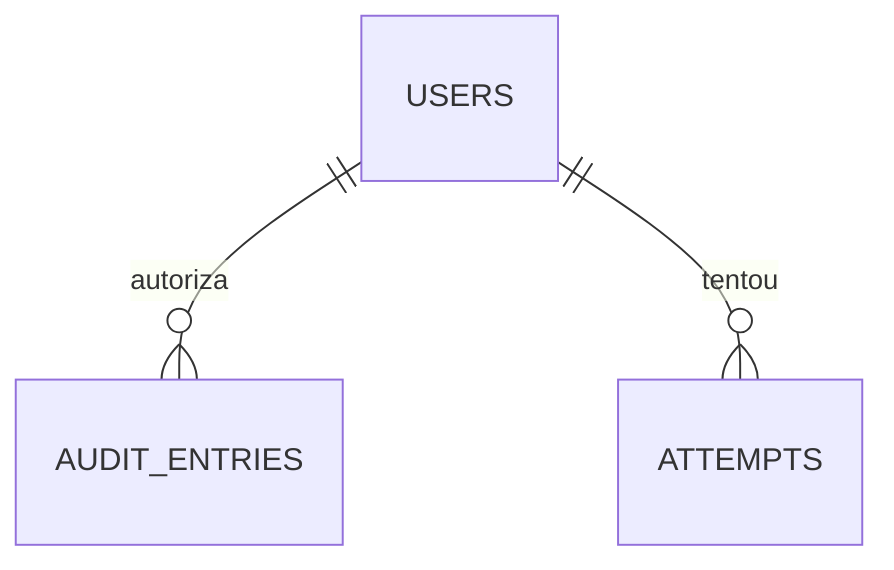

# Data Model — Diagramas de Entidade

Diagramas de **orientação**: mostram como os domínios se conectam, não cada chave estrangeira. A relação completa está na coluna `FK →` de cada tabela, em [`03-Data-Model.md`](./03-Data-Model.md), e a ordem de criação em [§ 4](./03-Data-Model.md#4-referential-integrity-and-creation-order).

Não é parte da especificação: nenhum diagrama aqui é normativo.

## The Request Cycle

## Access and Configuration

## Audit

