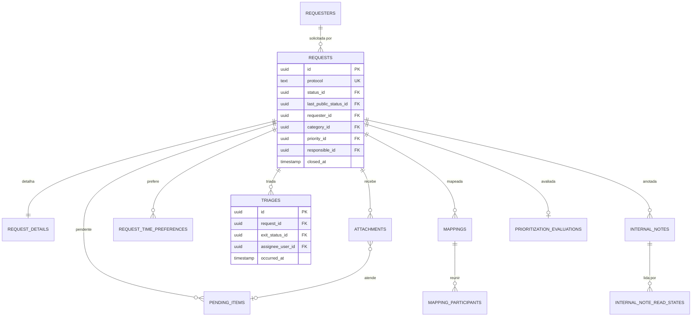
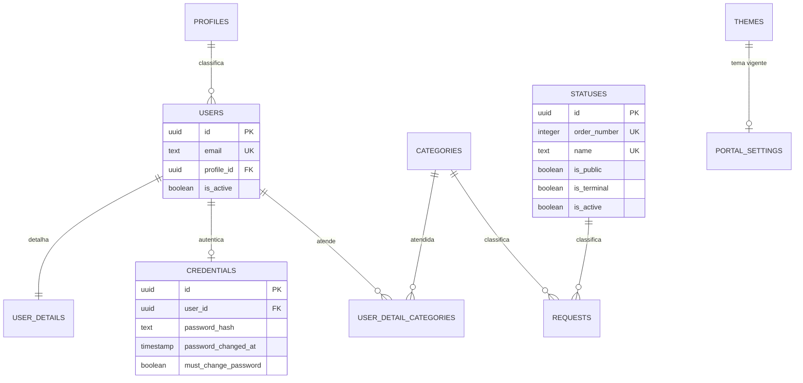
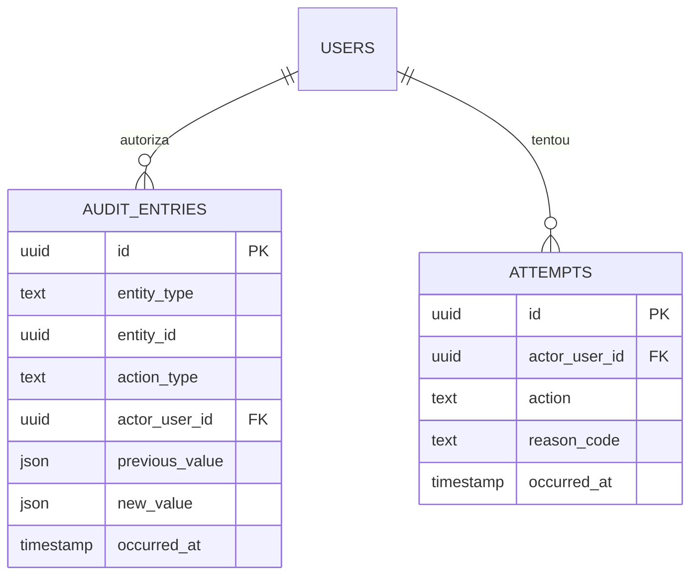

# Data Model

O modelo de dados do **MAAT** (Tirador de Pedidos): as tabelas, as colunas, as relações e as invariantes que a aplicação assume.

Este documento é **normativo**. A definição em Knex de cada domínio implementa o que está aqui; uma mudança de schema que não atualiza este documento é incompleta — ver [ADR-0010](./adr/0010-data-model-doc-is-the-spec.md). As convenções de nomenclatura e constraints estão em [ADR-0009](./adr/0009-schema-naming-and-constraints.md).

Documentos relacionados:

- [`01-Overview.md`](./01-Overview.md) — o sistema, o escopo, a stack.
- [`02-Architecture.md`](./02-Architecture.md) — camadas, injeção de dependências, persistência com Knex.
- [`../GLOSSARY.md`](../GLOSSARY.md) — vocabulário do domínio.
- [`adr/`](./adr/) — decisões de arquitetura registradas.

---

## 1. Scope and Source of Truth

O backend é organizado em doze domínios, cada um dono das suas tabelas ([ADR-0004](./adr/0004-domain-owned-schema-and-migrations.md)). Este documento descreve o schema completo: a soma das tabelas de cada domínio, mais a tabela de infraestrutura que não tem dono de domínio ([ADR-0011](./adr/0011-infrastructure-schema-without-domain-owner.md)).

O modelo é **novo**, escrito do zero: as migrations do legado são referência de dados e de regras, não de estrutura. Não há dado a migrar — o backend novo nasce com o banco vazio.

Três coisas convivem neste documento, e é útil saber qual é qual:

| Camada | Onde vive | Quem muda |
| --- | --- | --- |
| **Estrutura** — tabela, coluna, tipo, nulabilidade, constraint, índice | § 6 a § 18 deste documento | Domain owner, na definição em Knex do domínio |
| **Regras de negócio** — o que a coluna significa e que comportamento ela carrega | "Regras preservadas do legado" no fim de cada seção de domínio | Product + domain owner |
| **Decisões** — por que a estrutura é essa | [`adr/`](./adr/) | Architecture decision |

As regras de negócio **não** são inventadas aqui: o legado é a fonte de requisitos, e cada seção de domínio fecha com a lista do que a remodelagem preserva. Onde o legado tinha um defeito técnico — `ENUM` nativo, `btrim`, índice funcional, `CASCADE` — a estrutura muda e a regra não.

### 1.1 Inventário

25 tabelas em 12 domínios, mais 1 tabela de infraestrutura:

| Domínio | Tabelas | Escreve |
| --- | --- | --- |
| `auth` | `credentials` | `auth` |
| `users` | `profiles`, `users`, `user_details`, `user_detail_categories` | `users` |
| `requests` | `requests`, `request_details`, `requesters`, `attachments`, `request_time_preferences` | `requests` |
| `triage` | `triages` | `triage` |
| `mapping` | `mappings`, `mapping_participants` | `mapping` |
| `queue` | — *(projeção de leitura)* | — |
| `prioritization` | `criteria`, `priorities`, `prioritization_evaluations` | `prioritization` |
| `pending-items` | `pending_items` | `pending-items` |
| `internal-notes` | `internal_notes`, `internal_note_read_states` | `internal-notes` |
| `audit` | `audit_entries`, `attempts` | `audit` |
| `reports` | — *(projeção de leitura)* | — |
| `portal-config` | `portal_settings`, `themes`, `categories`, `statuses` | `portal-config` |
| `platform` | `code_counters` | `platform` (infraestrutura) |

---

## 2. Naming Conventions

As regras valem para todas as tabelas deste documento. A justificativa de cada uma está em [ADR-0009](./adr/0009-schema-naming-and-constraints.md).

### 2.1 Tables

`snake_case`, no plural, em inglês, com o nome do domínio reflected no nome quando a tabela é específica dele (`internal_notes`, `mapping_participants`). Tabela que descreve um documento 1:1 com outro usa o nome do pai com o sufixo `_details` (`request_details`).

### 2.2 Columns

`snake_case`. Booleanos com prefixo `is_` ou `has_`. Colunas de texto com limite de tamanho têm constraint `ck_` própria com o limite — a única forma portátil de impor o limite, já que o Postgres ignora `varchar(n)` e o MySQL não.

### 2.3 Primary Keys

Toda chave primária é `id`, UUID v4 gerado pela aplicação via porta `IdGenerator` ([ADR-0003](./adr/0003-knex-dialect-portability.md)). O schema não depende de `sequence`, `serial` ou `auto_increment`.

Exceção: tabelas singleton (`portal_settings`, `themes`) usam `id` UUID como chave e são garantidas pela aplicação e pelo seed — nenhuma constraint portable conta linhas.

### 2.4 Foreign Keys

Coluna nomeada `<entidade_no_singular>_id`, referenciando `id` da outra tabela. `ON DELETE RESTRICT` em todas.

A referência aponta para a **entidade**, nunca para a sua extensão 1:1. A identidade de uma pessoa é `users.id`; `user_details` é extensão de `users` e nunca é referenciada. A mesma regra vale para qualquer extensão 1:1 — `request_details` também é alcançada por `requests.id`.

Relações com **naturalmente mais de uma origem** são polimórficas e **não têm FK** — é o caso de `audit_entries.entity_id`, que aponta para qualquer entidade auditável. A regra é a exceção, não o padrão.

### 2.5 Timestamps

| Tipo de linha | Colunas |
| --- | --- |
| Linha mutável | `created_at` e `updated_at` |
| Linha de evento | `occurred_at` (tempo de negócio, não ordem de commit) |
| Linha append-only | `created_at` apenas |

Um único tipo de timestamp em toda a base, via `dialect.timestampType()`. `occurred_at` é tempo de negócio: com concorrência, duas transações podem comitar fora da ordem em que começaram, e a linha do tempo ordena por tempo de negócio ([ADR-0007](./adr/0007-event-driven-audit.md)).

### 2.6 Booleans

Prefixo `is_` ou `has_`. Um "enum" de dois valores é boolean: `categories.status` (active/inactive) virou `categories.is_active`, e `user_details.status` virou `user_details.is_available`.

### 2.7 Closed Value Sets

Cada conjunto fechado de valores é decidido por quatro testes, em ordem:

1. **O código enumera os valores?** → `text` com constraint `ck_` espelhando o catálogo do código. O catálogo no código é a fonte da verdade; a constraint é o espelho.
2. **O negócio precisa adicionar, remover ou reordenar valores em tempo de execução?** → tabela de referência.
3. **É um estado que o código transiciona?** → coluna, nunca linha de referência.
4. **É um "enum" de dois valores?** → boolean.

O discriminante é **quem possui o vocabulário**, não quem edita a linha: um administrador que escolhe um `statuses.tone` não possui o conjunto de tons.

Consequências:

- O mesmo conjunto nunca é armazenado duas vezes. Onde existe tabela de referência, o resto referencia por FK — `prioritization_evaluations.priority_id` substitui a cópia em texto da classificação.
- Tabela de referência referenciada **pelo código** precisa de chave estável: `profiles.name` **é** a chave de `core/authorization/profile-permissions.ts`.
- Tabela de referência referenciada **por id** não precisa de chave estável: `statuses` usa `id` e `order_number`.
- Adicionar um valor a um vocabulário do código toca o catálogo **e** a constraint `ck_` no mesmo pull request. São espelhos; um PR que muda um sem o outro está quebrado.

### 2.8 Indexes and Constraints

| Prefixo | Objeto |
| --- | --- |
| `pk_` | chave primária |
| `fk_` | chave estrangeira |
| `uk_` | unicidade |
| `idx_` | índice |
| `ck_` | constraint de check |

O nome carrega a tabela: `ck_attachments_size_bytes`, `uk_requests_protocol`, `idx_requests_status_id`, `fk_mapping_participants_mapping_id`. A tabela entra no nome porque MySQL e SQLite escopam nomes de constraint por tabela e o Postgres por schema — prefixar pela tabela torna o nome único nas três engines e autodescritivo.

Constraints são declaradas com o construtor do knex (`table.check(predicate, undefined, "ck_nome")`), nunca com `ALTER TABLE` escrito à mão: `db.raw()` fora da porta `Dialect` é proibido ([ADR-0003](./adr/0003-knex-dialect-portability.md)).

Uma constraint de check **não enxerga outras linhas**. Invariante que depende de mais de uma linha — duas faixas de prioridade que não podem se sobrepor, por exemplo — é regra de aplicação e aparece listada como invariante na seção do domínio.

### 2.9 Text, Numbers and JSON

- Texto com limite: `text` + `ck_` de comprimento. Texto sem limite: `text`.
- Decimal com precisão explícita: `decimal(5,1)` para o score de priorização, `decimal(3,2)` para o peso padrão da faixa.
- JSON via `dialect.jsonType()`. A **forma** do JSON é validada na borda, com Zod ([02-Architecture § 13](./02-Architecture.md#13-validation-and-the-border)): `json_typeof()` é Postgres, e o equivalente diverge entre MySQL e SQLite.

### 2.10 Normalization

- **E-mail** é armazenado em minúsculas (`trim().toLowerCase()`) e único sobre o valor armazenado. O login normaliza antes de comparar.
- **Unicidade sem distinção de caixa** que não possa ser feita com `LOWER()` — porque índice funcional não é portátil — usa **coluna normalizada** mantida pela aplicação e única: `categories.normalized_name`.
- `requesters.corporate_email` **não** é único, de propósito: mais de um solicitante pode usar a mesma caixa corporativo. Não é um defeito.

### 2.11 Delete Policy

`ON DELETE RESTRICT` em todas as chaves estrangeiras. Não há `CASCADE` nem `SET NULL` em lugar nenhum do modelo.

A política é uma afirmação sobre o domínio: **nada é apagado**.

| Entidade | Como se retira |
| --- | --- |
| Solicitação | Encerrada (`closed_at`), nunca excluída |
| Usuário | Desativado (`users.is_active = false`), nunca excluído |
| Perfil, categoria, status, prioridade, critério | Desativado (`is_active = false`), nunca excluído |
| Nota interna, triagem, mapeamento, pendência, anexo | Não há rota de exclusão; a solicitação que os contém não é excluída |

Por isso a exclusão de um status em uso é bloqueada pelo banco, e o caminho para retirá-lo é desativá-lo.

---

## 3. Vocabulary to Schema

O glossário é a fonte do vocabulário; estas são as tabelas onde cada termo vive.

| Termo (`GLOSSARY.md`) | Onde vive | Observação |
| --- | --- | --- |
| **Solicitação** | `requests.requests` | O registro e seu ciclo de vida |
| **Protocolo** | `requests.requests.protocol` | Identificador público, único, nunca reemitido |
| **Solicitante** | `requests.requesters` | Pode ser anônimo (`requester_user_id` nulo) |
| **Anexo** | `requests.attachments` | Vinculado à solicitação e, opcionalmente, a uma pendência |
| **Fila** | — | Projeção de leitura sobre `requests`; sem tabela própria |
| **Status** | `portal-config.statuses` | Etapa do ciclo de vida, com visibilidade pública ou interna |
| **Categoria** | `portal-config.categories` | Classificação ordenável da fila |
| **Prioridade** | `prioritization.priorities` | Faixa de criticidade, definida por faixa de score |
| **Triagem** | `triage.triages` | Histórico append-only; a triagem atual é a última linha |
| **Veredito** | `triage.triages.result` | Resultado da triagem |
| **Mapeamento** | `mapping.mappings` | Sessão de levantamento |
| **Análise de viabilidade** | — | Etapa do mapeamento; registrada em `mappings` e na auditoria, sem tabela própria |
| **Priorização** | `prioritization.prioritization_evaluations` | Cálculo da prioridade a partir de critérios ponderados |
| **Critério** | `prioritization.criteria` | Quesito ponderado, com peso ajustável |
| **Pendência** | `pending-items.pending_items` | Item que impede o avanço da solicitação |
| **Nota interna** | `internal-notes.internal_notes` | Registro imutável, integrado à linha do tempo |
| **Linha do tempo** | — | Projeção: `audit_entries` + `internal_notes` |
| **Auditoria** | `audit.audit_entries` | O que foi alterado, com autor, momento, valor anterior e novo |
| **Tentativa** | `audit.attempts` | O que foi recusado, gravado fora da transação |
| **Perfil** | `users.profiles` | Cinco perfis; permissões em código ([ADR-0006](./adr/0006-static-profile-authorization.md)) |
| **Admin Root** | `users.profiles` | Existe apenas no seed; nunca há auto-registro |
| **Responsável** | `requests.requests.responsible_id`, `triage.triages.assignee_user_id`, `mapping.mappings.responsible_id` | O Analista designado |
| **Modo de acesso** | `portal-config.portal_settings.solicitation_mode` | `PUBLIC` ou `AUTHENTICATED` |

---

## 4. Referential Integrity and Creation Order

Toda referência entre tabelas é uma FK com `ON DELETE RESTRICT`, inclusive entre domínios. Code autonomy e DB autonomy são coisas diferentes: a FK é declarada **na migration do domínio que referencia**, e altera apenas a tabela que referencia — a regra da [ADR-0004](./adr/0004-domain-owned-schema-and-migrations.md) proíbe migration que altera tabelas de dois domínios, não migration que aponta para a tabela de outro.

Duas consequências operacionais:

**Ordem de criação.** A tabela referenciada precisa existir antes da que a referencia. O knex ordena as migrations globalmente pelo prefixo de timestamp, então a ordem abaixo é a ordem dos timestamps das migrations:

| # | Domínio | Tabelas |
| --- | --- | --- |
| 1 | `users` | `profiles`, `users`, `user_details` |
| 2 | `portal-config` | `statuses`, `categories`, `themes` |
| 3 | `users` | `user_detail_categories` |
| 4 | `prioritization` | `criteria`, `priorities` |
| 5 | `auth` | `credentials` |
| 6 | `requests` | `requesters`, `requests`, `request_details`, `attachments`, `request_time_preferences` |
| 7 | `triage` | `triages` |
| 8 | `mapping` | `mappings`, `mapping_participants` |
| 9 | `pending-items` | `pending_items` |
| 10 | `internal-notes` | `internal_notes`, `internal_note_read_states` |
| 11 | `prioritization` | `prioritization_evaluations` |
| 12 | `audit` | `audit_entries`, `attempts` |
| 13 | `platform` | `code_counters` |

**Desmontagem.** Renomear ou excluir uma tabela referenciada exige antes remover a FK que a aponta — e essa migration é do domínio que referencia. É o único ponto em que a autonomy de um domínio toca a de outro, e ele é explícito.

**Exceções ao padrão.** Duas relações não têm FK:

| Relação | Por quê |
| --- | --- |
| `audit_entries.entity_id` → qualquer entidade | Referência polimórfica por natureza |
| `audit_entries.entity_type` / `action_type` | Vocabulário do código, espelhado em `ck_` |

---

## 5. Entity-Relationship Overview

### 5.1 The Request Cycle

### 5.2 Access and Configuration

### 5.3 Audit

---

## 6. Domain `auth`

Responsabilidade: login, logout, sessão, troca de senha. Publica a porta `AuthReader`. É o único domínio que enxerga material de senha.

### 6.1 `credentials`

Material de credencial do usuário. Separado de `users` para que o domínio `users` nunca segure segredo: `UserReader` não pode vazar hash, e nenhuma listagem de usuários precisa se lembrar de excluir uma coluna.

| Coluna | Tipo | Nulo | Default | Notas |
| --- | --- | --- | --- | --- |
| `id` | uuid | não | — | PK, UUID v4 gerado pela aplicação |
| `user_id` | uuid | não | — | FK → `users.id`, UNIQUE `uk_credentials_user_id` |
| `password_hash` | text | não | — | `ck_credentials_password_hash_length` ≤ 255 |
| `password_changed_at` | timestamp | não | `now` | Época de revogação dos tokens |
| `must_change_password` | boolean | não | `true` | Trava todas as rotas exceto `/auth/me` e `/auth/change-password` |
| `created_at` | timestamp | não | `now` | Sem `updated_at`: a única mutação é a troca de senha, já marcada em `password_changed_at` |

**Relações** — `user_id` → `users.id` (RESTRICT).

**Índices** — `uk_credentials_user_id` (único).

**Invariantes**

- Uma credencial por usuário, e todo usuário tem credencial. `Admin Root` é criado no seed.
- O hash é bcrypt (`$2b$10$…`): algoritmo e custo estão na própria string, então trocar de algoritmo não exige migration.
- `password_changed_at` nunca anda para trás. Um token emitido antes do valor atual é recusado — é o mecanismo de revogação.
- A senha nunca é armazenada; só o hash. A resposta de login é idêntica para e-mail inexistente, conta inativa e senha errada.
- **Não existe tabela de sessões.** A sessão é o token: JWT em cookie `HttpOnly`, relido do banco a cada requisição ([02-Architecture § 14.1](./02-Architecture.md#141-session)). Logout encerra o cookie; a janela de exposição é o TTL. Desativar a conta ou trocar a senha invalida todos os tokens emitidos.

**Regras preservadas do legado**

- bcrypt com custo 10.
- Resposta única de login — "credenciais inválidas" — para e-mail inexistente, conta inativa, perfil inativo e senha errada, com comparação de tempo uniforme (hash de mentira quando o usuário não existe).
- `must_change_password` bloqueia tudo, exceto a própria troca e a consulta de sessão; a resposta é 403.
- Senha temporária gerada por CSPRNG, com 14 caracteres, exibida uma única vez ao administrador, e que obriga a troca.
- Troca de senha exige a senha atual e proíbe que a nova seja igual à atual.
- A troca de senha grava o registro de auditoria **na mesma transação**; se a auditoria falhar, a troca é desfeita ([ADR-0007](./adr/0007-event-driven-audit.md)).

---

## 7. Domain `users`

Responsabilidade: cadastro, perfil, dados do usuário, avatar. Publica a porta `UserReader`. As permissões são uma matriz em código ([ADR-0006](./adr/0006-static-profile-authorization.md)); o banco guarda **quem é** cada perfil, não **o que ele pode**.

### 7.1 `profiles`

Os cinco perfis do produto. `name` é a chave estável: é o mesmo valor usado em `core/authorization/profile-permissions.ts`.

| Coluna | Tipo | Nulo | Default | Notas |
| --- | --- | --- | --- | --- |
| `id` | uuid | não | — | PK, UUID v4 |
| `name` | text | não | — | UNIQUE `uk_profiles_name`. Valores: `Solicitante`, `Analista`, `Gestor`, `Administrador`, `Admin Root` |
| `is_active` | boolean | não | `true` | Perfil desativado impede o acesso de todos os usuários daquele perfil |
| `created_at` | timestamp | não | `now` | |
| `updated_at` | timestamp | não | `now` | |

**Relações** — `users.profile_id` → `profiles.id` (RESTRICT).

**Índices** — `uk_profiles_name`.

**Invariantes**

- As linhas semeadas são exatamente as chaves do catálogo de permissões em código. Divergência entre o seed e a matriz é um bug de autorização silencioso.
- Perfil é desativado, nunca excluído: há usuário apontando para ele.
- `Admin Root` existe apenas no seed. Não há auto-registro.

### 7.2 `users`

A conta. Não carrega material de senha — esse é do domínio `auth`.

| Coluna | Tipo | Nulo | Default | Notas |
| --- | --- | --- | --- | --- |
| `id` | uuid | não | — | PK, UUID v4 |
| `name` | text | não | — | `ck_users_name_length` ≤ 150 |
| `email` | text | não | — | UNIQUE `uk_users_email`, `ck_users_email_length` ≤ 254, armazenado em minúsculas |
| `profile_id` | uuid | não | — | FK → `profiles.id` (RESTRICT) |
| `is_active` | boolean | não | `true` | Desativar a conta invalida todos os tokens imediatamente |
| `avatar_url` | text | sim | — | `ck_users_avatar_url_length` ≤ 500 |
| `created_at` | timestamp | não | `now` | |
| `updated_at` | timestamp | não | `now` | |

**Relações** — `profile_id` → `profiles.id` (RESTRICT).

**Índices** — `uk_users_email`.

**Invariantes**

- O e-mail é armazenado normalizado e único sobre o valor armazenado. E-mails que diferem só por caixa são o mesmo e-mail.
- O token **não** carrega o perfil como autoridade: o middleware relê usuário e perfil do banco a cada requisição ([02-Architecture § 14.1](./02-Architecture.md#141-session)). Desativação e mudança de perfil valem na hora.
- Usuário não é excluído. Desativar é o caminho de retirada.

### 7.3 `user_details`

Dados adicionais do usuário interno: cargo, especialidades, áreas atendidas, disponibilidade. É a extensão 1:1 de `users`.

| Coluna | Tipo | Nulo | Default | Notas |
| --- | --- | --- | --- | --- |
| `id` | uuid | não | — | PK, UUID v4 |
| `user_id` | uuid | não | — | FK → `users.id`, UNIQUE `uk_user_details_user` |
| `job_title` | text | sim | — | `ck_user_details_job_title_length` ≤ 100 |
| `specialties` | text | sim | — | Texto livre |
| `is_available` | boolean | não | `true` | Disponibilidade do profissional — **não** é a conta |
| `capacity` | integer | não | `5` | `ck_user_details_capacity_non_negative` ≥ 0 |
| `notes` | text | sim | — | |
| `created_at` | timestamp | não | `now` | |
| `updated_at` | timestamp | não | `now` | |

**Relações** — `user_id` → `users.id` (RESTRICT).

**Índices** — `uk_user_details_user`.

**Invariantes**

- Um `user_details` por usuário, no máximo.
- `is_available` e `users.is_active` são coisas diferentes: a conta pode estar ativa e o profissional indisponível. Só `users.is_active` derruba token.

### 7.4 `user_detail_categories`

Áreas atendidas pelo usuário interno. Tabela filha, e não coluna `ARRAY` ou texto com ids ([02-Architecture § 10.3](./02-Architecture.md#103-portability-rules)). Aponta para `users.id` — a identidade do profissional é a conta, e não a extensão 1:1.

| Coluna | Tipo | Nulo | Default | Notas |
| --- | --- | --- | --- | --- |
| `id` | uuid | não | — | PK, UUID v4 |
| `user_id` | uuid | não | — | FK → `users.id` (RESTRICT) |
| `category_id` | uuid | não | — | FK → `portal-config.categories.id` (RESTRICT) |

**Índices** — UNIQUE `uk_user_detail_categories_user_category` (`user_id`, `category_id`).

**Invariantes**

- A mesma categoria não é atendida duas vezes pelo mesmo usuário.
- Quem atende categorias tem extensão: uma linha em `user_detail_categories` pressupõe a linha correspondente em `user_details`, criada na mesma transação. É regra de aplicação — uma constraint de check não enxerga outras linhas.

**Regras preservadas do legado**

- Cinco perfis, com hierarquia, e `Admin Root` apenas no seed.
- Perfil pode ser desativado no banco, e a desativação vale imediatamente.
- Um profissional atende a um conjunto de categorias; a lista era uma coluna de texto com ids e virou tabela filha.
- Usuário e perfil têm documento próprio de dados (cargo, especialidades, disponibilidade, capacidade).

---

## 8. Domain `requests`

Responsabilidade: ciclo de vida da solicitação, protocolo, anexos. Publica a porta `RequestReader`.

### 8.1 `requests`

O registro da solicitação e seu estado de ciclo de vida. O formulário de intake vive em `request_details` — a tabela `requests` é a entidade, não o formulário.

| Coluna | Tipo | Nulo | Default | Notas |
| --- | --- | --- | --- | --- |
| `id` | uuid | não | — | PK, UUID v4 |
| `protocol` | text | não | — | UNIQUE `uk_requests_protocol`, `ck_requests_protocol_length` ≤ 25 |
| `requester_id` | uuid | não | — | FK → `requesters.id` (RESTRICT) |
| `requester_user_id` | uuid | sim | — | FK → `users.id` (RESTRICT) — nulo quando o solicitante é anônimo |
| `title` | text | não | — | `ck_requests_title_length` ≤ 150 |
| `status_id` | uuid | não | — | FK → `portal-config.statuses.id` (RESTRICT) — status interno atual |
| `last_public_status_id` | uuid | sim | — | FK → `portal-config.statuses.id` (RESTRICT) — último status visível ao solicitante |
| `category_id` | uuid | não | — | FK → `portal-config.categories.id` (RESTRICT) |
| `priority_id` | uuid | sim | — | FK → `prioritization.priorities.id` (RESTRICT) |
| `responsible_id` | uuid | sim | — | FK → `users.id` (RESTRICT) — o Responsável |
| `estimated_completion` | date | sim | — | Data estimada de conclusão |
| `meeting_scheduled_for` | timestamp | sim | — | Reunião combinada, publicada ao solicitante |
| `meeting_link` | text | sim | — | `ck_requests_meeting_link_length` ≤ 500 |
| `last_technical_message` | text | sim | — | Última mensagem técnica publicada |
| `last_external_update_at` | timestamp | sim | — | Última atualização feita pelo solicitante |
| `closed_at` | timestamp | sim | — | Momento do encerramento |
| `created_by` | text | não | — | `ck_requests_created_by_length` ≤ 100 — rótulo de quem abriu |
| `created_by_user_id` | uuid | sim | — | FK → `users.id` (RESTRICT) — nulo quando o registro é do portal público |
| `created_at` | timestamp | não | `now` | |
| `updated_at` | timestamp | não | `now` | |

**Relações** — `requester_id` → `requesters.id`; `requester_user_id` → `users.id`; `status_id` e `last_public_status_id` → `portal-config.statuses.id`; `category_id` → `portal-config.categories.id`; `priority_id` → `prioritization.priorities.id`; `responsible_id` → `users.id`; `created_by_user_id` → `users.id`.

**Índices** — UNIQUE `uk_requests_protocol`; `idx_requests_status_id`; `idx_requests_requester_id`; `idx_requests_category_id`; `idx_requests_priority_id`; `idx_requests_responsible_id`; `idx_requests_created_at`.

**Invariantes**

- O protocolo é produzido pelo contador (`code_counters`), nunca reemitido, e único por constraint — belt-and-braces sobre a bijeção da cifra ([ADR-0008](./adr/0008-protocol-without-collision-risk.md)). A leitura por protocolo **nunca** usa `.first()`: é uma sondagem com `LIMIT 2` que falha explicitamente se duas linhas corresponderem.
- `last_public_status_id` nunca está à frente de `status_id`: quando o status interno é restrito, o solicitante continua vendo o último status público. É assim que a solicitação é encerrada para o solicitante sem revelar o trâmite interno.
- `closed_at` é gravado na mesma transação da mudança de status que entra num status terminal (`statuses.is_terminal`), e é zerado se a solicitação volta a um status não terminal.
- O solicitante pode ser anônimo: `requester_user_id` é nulo e a identidade vem de `requesters`.
- `created_by` é um rótulo, não uma referência — o portal público não tem usuário. `created_by_user_id` é a referência quando existe.
- A solicitação não é excluída.

**Regras preservadas do legado**

- O protocolo é público, curto e não enumerável, e permite ao solicitante acompanhar a solicitação sem expor identidade interna.
- O solicitante acompanha pelo protocolo; no modo público, a checagem de dono é feita pelo serviço.
- O solicitante pode ser anônimo ou autenticado; quando autenticado, `requester_user_id` o liga à conta.
- O status público e o status interno são distintos, e o solicitante enxerga o último público.
- A solicitação guarda data estimada de conclusão, reunião combinada e última mensagem técnica — o que o portal publica ao solicitante.
- Pedir atualização de campo abre pendência, não edita a solicitação diretamente.

### 8.2 `request_details`

O formulário de intake da solicitação: os dados que o solicitante preenche. Relação 1:1 com `requests`.

| Coluna | Tipo | Nulo | Default | Notas |
| --- | --- | --- | --- | --- |
| `request_id` | uuid | não | — | PK e FK → `requests.id` (RESTRICT) |
| `request_type` | text | não | — | `ck_request_details_request_type_length` ≤ 80 |
| `process_name` | text | não | — | ≤ 150 |
| `need_description` | text | não | — | ≤ 4000 |
| `problem_opportunity` | text | não | — | ≤ 4000 |
| `expected_result` | text | não | — | ≤ 4000 |
| `justification` | text | não | — | ≤ 4000 |
| `process_description` | text | não | — | ≤ 4000 |
| `process_steps` | text | não | — | ≤ 4000 |
| `systems_used` | text | não | — | ≤ 255 |
| `execution_frequency` | text | não | — | ≤ 50 — texto livre |
| `approximate_volume` | text | não | — | ≤ 100 — texto livre |
| `people_involved` | integer | não | — | `ck_request_details_people_involved_positive` > 0 |
| `average_duration` | text | não | — | ≤ 60 — texto livre |
| `estimated_monthly_effort` | decimal | não | — | `ck_request_details_effort_non_negative` ≥ 0 |
| `has_manual_controls` | boolean | não | — | |
| `manual_controls_detail` | text | sim | — | ≤ 1000 |
| `main_risks` | text | não | — | ≤ 2000 |
| `client_impact` | text | não | — | ≤ 2000 |
| `process_documentation` | boolean | sim | — | |
| `process_documentation_detail` | text | sim | — | ≤ 1000 |
| `has_similar_solution` | boolean | sim | — | |
| `similar_solution_detail` | text | sim | — | ≤ 1000 |
| `depends_on_other_areas` | boolean | sim | — | |
| `other_areas_detail` | text | sim | — | ≤ 1000 |
| `handles_restricted_info` | boolean | sim | — | |
| `restricted_info_detail` | text | sim | — | ≤ 1000 |
| `additional_notes` | text | sim | — | ≤ 2000 |
| `operational_impact` | text | não | — | `ck_request_details_operational_impact` ∈ `Baixo`, `Médio`, `Alto`, `Crítico` |
| `perceived_criticality` | text | não | — | `ck_request_details_perceived_criticality` ∈ `Baixa`, `Média`, `Alta`, `Crítica` |
| `desired_deadline` | date | não | — | Data desejada |

**Relações** — `request_id` → `requests.id` (RESTRICT), PK e FK na mesma coluna.

**Invariantes**

- Toda solicitação tem detalhe: a abertura de uma solicitação grava as duas linhas na mesma transação.
- `operational_impact` e `perceived_criticality` são vocabulário do código, com os valores em português — é o texto que o produto já usa.
- `request_type`, `execution_frequency`, `average_duration` e `approximate_volume` são **texto livre**, como no legado. São os candidatos naturais a tabela de referência se o produto algum dia quiser vocabulário controlado; hoje são texto.

**Regras preservadas do legado**

- O formulário de intake é o mesmo: os campos, os limites e as obrigatoriedades.
- Os impactos operacionais e a criticidade percebida são escalas de quatro níveis.

### 8.3 `requesters`

Quem abriu a solicitação. Existe mesmo quando a abertura é anônima.

| Coluna | Tipo | Nulo | Default | Notas |
| --- | --- | --- | --- | --- |
| `id` | uuid | não | — | PK, UUID v4 |
| `full_name` | text | não | — | `ck_requesters_full_name_length` ≤ 150 |
| `corporate_email` | text | não | — | `ck_requesters_corporate_email_length` ≤ 254 — **não** único |
| `area` | text | sim | — | ≤ 100 — nula para extensão de usuário |
| `department` | text | sim | — | ≤ 100 |
| `manager_name` | text | sim | — | ≤ 150 — nula para extensão de usuário |
| `additional_contact` | text | sim | — | ≤ 100 |
| `user_id` | uuid | sim | — | FK → `users.id` (RESTRICT), UNIQUE `uk_requesters_user` |
| `created_at` | timestamp | não | `now` | |

**Índices** — `idx_requesters_corporate_email`; `idx_requesters_area`; UNIQUE `uk_requesters_user`.

**Invariantes**

- `corporate_email` pode se repetir: mais de um solicitante pode usar a mesma caixa. O índice é de busca, não de unicidade.
- `user_id` liga o solicitante à conta quando existe, e é único — uma conta tem um solicitante.

### 8.4 `attachments`

Arquivos enviados com a solicitação.

| Coluna | Tipo | Nulo | Default | Notas |
| --- | --- | --- | --- | --- |
| `id` | uuid | não | — | PK, UUID v4 |
| `request_id` | uuid | não | — | FK → `requests.id` (RESTRICT) |
| `pending_item_id` | uuid | sim | — | FK → `pending-items.pending_items.id` (RESTRICT) |
| `file_name` | text | não | — | ≤ 255 |
| `file_path` | text | não | — | ≤ 1000 — caminho do arquivo no armazenamento |
| `content_type` | text | não | — | `ck_attachments_content_type` ∈ `application/pdf`, `application/vnd.openxmlformats-officedocument.wordprocessingml.document`, `application/vnd.openxmlformats-officedocument.spreadsheetml.sheet`, `image/png`, `image/jpeg` |
| `size_bytes` | integer | não | — | `ck_attachments_size_bytes` > 0 e ≤ 10485760 |
| `is_restricted` | boolean | não | `false` | Anexo de conteúdo restrito |
| `uploaded_by` | text | não | — | ≤ 100 |
| `uploaded_at` | timestamp | não | `now` | |

**Índices** — `idx_attachments_request_id`; `idx_attachments_pending_item_id`; `idx_attachments_is_restricted`.

**Invariantes**

- O arquivo vive fora do banco; a tabela guarda o ponteiro, o tamanho e o tipo.
- `pending_item_id` liga o anexo à pendência que ele atende.

### 8.5 `request_time_preferences`

Slots de horário que o solicitante marcou como preferência.

| Coluna | Tipo | Nulo | Default | Notas |
| --- | --- | --- | --- | --- |
| `id` | uuid | não | — | PK, UUID v4 |
| `request_id` | uuid | não | — | FK → `requests.id` (RESTRICT) |
| `scheduled_for` | timestamp | não | — | Mesmo tipo de timestamp do resto da base |
| `created_at` | timestamp | não | `now` | |

**Índices** — UNIQUE `uk_request_time_preferences_slot` (`request_id`, `scheduled_for`).

**Invariantes**

- O mesmo slot não é registrado duas vezes para a mesma solicitação.

---

## 9. Domain `triage`

Responsabilidade: triagem — aderência, escopo, veredito. Publica a porta `TriageReader`.

### 9.1 `triages`

Histórico de triagens. Cada triagem é uma linha nova; a triagem atual é a última.

| Coluna | Tipo | Nulo | Default | Notas |
| --- | --- | --- | --- | --- |
| `id` | uuid | não | — | PK, UUID v4 |
| `request_id` | uuid | não | — | FK → `requests.id` (RESTRICT) |
| `adherent_to_scope` | text | não | — | `ck_triages_adherent_to_scope` ∈ `Sim`, `Não`, `` |
| `adherent_justification` | text | não | `` | Justificativa da aderência |
| `change_category` | text | não | — | `ck_triages_change_category` ∈ `Sim`, `Não`, `` |
| `new_category` | text | não | `` | ≤ 40 — categoria proposta quando a triagem muda a classificação |
| `preliminary_complexity` | text | não | `` | |
| `perceived_risks` | text | não | `` | |
| `suggested_responsible` | text | não | `` | ≤ 150 — **texto livre**, é sugestão, não vínculo |
| `suggested_responsible_justification` | text | não | `` | |
| `assignee_user_id` | uuid | sim | — | FK → `users.id` (RESTRICT) — o Responsável designado |
| `assignee_name` | text | sim | — | Rótulo do responsável no momento da triagem |
| `assignee_email` | text | sim | — | E-mail do responsável no momento da triagem |
| `exit_status_id` | uuid | não | — | FK → `portal-config.statuses.id` (RESTRICT) — status de saída da triagem |
| `result` | text | não | — | ≤ 1000 — o Veredito |
| `conclusion_justification` | text | não | — | |
| `last_technical_message` | text | sim | — | Mensagem técnica associada |
| `author_user_id` | uuid | não | — | FK → `users.id` (RESTRICT) — quem triou |
| `occurred_at` | timestamp | não | `now` | Tempo de negócio, não ordem de commit |

**Relações** — `request_id` → `requests.id`; `exit_status_id` → `portal-config.statuses.id`; `assignee_user_id` e `author_user_id` → `users.id`.

**Índices** — `idx_triages_request_id_occurred_at` (`request_id`, `occurred_at`).

**Invariantes**

- `triages` é a **única** casa do resultado da triagem. A solicitação não tem cópia de triagem: as colunas de triagem que existiam em `requests` no legado foram removidas.
- A triagem é append-only: corrigir uma triagem é registrar outra linha.
- `suggested_responsible` é texto livre — a triagem sugere um nome. O vínculo é `assignee_user_id`, e é o responsável efetivo. O rótulo e o e-mail congelam quem era o responsável no momento.
- `occurred_at` ordena a linha do tempo da triagem por tempo de negócio.

**Regras preservadas do legado**

- A triagem registra aderência ao escopo, mudança de categoria, complexidade preliminar, riscos percebidos, responsável sugerido com justificativa, status de saída e resultado com justificativa.
- O resultado é o Veredito: elegível, pendente de informações, fora do escopo, direcionada, duplicada, cancelada ou backlog.
- A triagem é histórico versionado: cada avaliação é uma linha nova e a leitura atual é a última.
- A proveniência (ator, momento, origem) fica na auditoria; a linha carrega o próprio autor e o próprio tempo para ser legível sem JOIN.

---

## 10. Domain `mapping`

Responsabilidade: sessão de mapeamento, participantes, agenda. Publica a porta `MappingReader`.

### 10.1 `mappings`

| Coluna | Tipo | Nulo | Default | Notas |
| --- | --- | --- | --- | --- |
| `id` | uuid | não | — | PK, UUID v4 |
| `request_id` | uuid | não | — | FK → `requests.id` (RESTRICT) |
| `responsible_id` | uuid | sim | — | FK → `users.id` (RESTRICT) — o Analista conduz o mapeamento |
| `scheduled_for` | timestamp | sim | — | ISO-8601 com offset, persistido em UTC |
| `duration_minutes` | integer | sim | — | `ck_mappings_duration_minutes` ≥ 15 e ≤ 480 |
| `modality` | text | sim | — | `ck_mappings_modality` ∈ `REMOTE`, `IN_PERSON` |
| `meeting_link` | text | sim | — | ≤ 500 |
| `location` | text | sim | — | ≤ 500 |
| `notes` | text | sim | — | ≤ 2000 |
| `justification` | text | sim | — | Justificativa da transição |
| `last_technical_message` | text | sim | — | Mensagem técnica associada |
| `target_status_id` | uuid | sim | — | FK → `portal-config.statuses.id` (RESTRICT) — status de destino do mapeamento |
| `is_concluded` | boolean | não | `false` | |
| `concluded_at` | timestamp | sim | — | |
| `created_by_user_id` | uuid | não | — | FK → `users.id` (RESTRICT) |
| `created_at` | timestamp | não | `now` | |
| `updated_by_user_id` | uuid | sim | — | FK → `users.id` (RESTRICT) |
| `updated_at` | timestamp | sim | — | |

**Relações** — `request_id` → `requests.id`; `responsible_id` e `created_by_user_id` → `users.id`; `target_status_id` → `portal-config.statuses.id`.

**Índices** — `idx_mappings_request_id`; `idx_mappings_request_id_is_concluded`.

**Invariantes**

- Uma solicitação pode ter vários mapeamentos, mas **no máximo um aberto** — o mapeamento atual é o mais recente não concluído. A unicidade é da aplicação, garantida na transação que conclui o anterior.
- `scheduled_for` é persistido em UTC e devolvido com `Z`.
- A duração, quando informada, está entre 15 e 480 minutos.

### 10.2 `mapping_participants`

Participantes do mapeamento: internos (ligados a uma conta) ou externos (nome e e-mail informados na hora).

| Coluna | Tipo | Nulo | Default | Notas |
| --- | --- | --- | --- | --- |
| `id` | uuid | não | — | PK, UUID v4 |
| `mapping_id` | uuid | não | — | FK → `mappings.id` (RESTRICT) |
| `user_id` | uuid | sim | — | FK → `users.id` (RESTRICT) — participante interno |
| `name` | text | sim | — | ≤ 255 |
| `email` | text | sim | — | ≤ 255 — armazenado em minúsculas |
| `created_at` | timestamp | não | `now` | |

**Índices** — UNIQUE `uk_mapping_participants_user` (`mapping_id`, `user_id`); UNIQUE `uk_mapping_participants_email` (`mapping_id`, `email`).

**Invariantes**

- O mesmo usuário não aparece duas vezes no mesmo mapeamento. Participantes externos têm `user_id` nulo, e nulos não colidem entre si — vários externos são permitidos.
- A unicidade por e-mail é case-insensitive sem índice funcional: o e-mail é normalizado na gravação e a unicidade é sobre o valor armazenado.

**Regras preservadas do legado**

- O mapeamento tem data, duração, modalidade, link, local e notas; e pode ser concluído, com registro de conclusão.
- Participante interno vem do cadastro; participante externo vem do payload, com nome e e-mail.
- O mapeamento é o registro da sessão de levantamento; a análise de viabilidade é uma etapa dele, sem tabela própria.

---

## 11. Domain `queue`

Responsabilidade: fila centralizada e métricas. **Não tem tabelas** — é uma projeção de leitura sobre `requests` e as tabelas de configuração, e consome as portas publicadas por outros domínios ([02-Architecture § 5](./02-Architecture.md#5-domain-catalog)).

A ordenação da fila é **derivada**, nunca armazenada: `categories.display_order` ordena o card, `statuses.order_number` ordena a etapa, `prioritization.priorities.min_score` ordena a prioridade. Não existe coluna de ordenação em `requests` — ela envelheceria e passaria a discordar da configuração.

A projeção consome: `requests.requests`, `portal-config.statuses`, `portal-config.categories`, `prioritization.priorities`, `users.users`.

---

## 12. Domain `prioritization`

Responsabilidade: critérios, pesos e a Prioridade resultante. Publica a porta `PrioritizationReader`.

### 12.1 `criteria`

Quesitos ponderados do cálculo.

| Coluna | Tipo | Nulo | Default | Notas |
| --- | --- | --- | --- | --- |
| `id` | uuid | não | — | PK, UUID v4 |
| `code` | text | não | — | UNIQUE `uk_criteria_code` ≤ 50 — o identificador estável do critério |
| `name` | text | não | — | ≤ 100 |
| `weight` | integer | não | — | `ck_criteria_weight_positive` > 0 |
| `is_active` | boolean | não | `true` | Critério desativado sai do cálculo |
| `display_order` | integer | não | — | |
| `created_at` | timestamp | não | `now` | |
| `updated_at` | timestamp | não | `now` | |

**Índices** — UNIQUE `uk_criteria_code`.

**Invariantes**

- O peso é positivo. Critério desativado não participa do cálculo, mas mantém a linha e o histórico.

### 12.2 `priorities`

Faixas de criticidade. A faixa é definida por faixa de score — por isso a tabela mora no domínio da priorização, e não no de configuração do portal.

| Coluna | Tipo | Nulo | Default | Notas |
| --- | --- | --- | --- | --- |
| `id` | uuid | não | — | PK, UUID v4 |
| `level` | text | não | — | UNIQUE `uk_priorities_level` ≤ 50 — `Baixa`, `Média`, `Alta`, `Crítica` |
| `min_score` | integer | não | — | `ck_priorities_score_range` — `min_score` ≤ `max_score` |
| `max_score` | integer | não | — | |
| `default_weight` | decimal | não | — | `decimal(3,2)` — peso padrão da faixa |
| `color_code` | text | sim | — | ≤ 50 |
| `description` | text | sim | — | |
| `is_active` | boolean | não | `true` | Faixa desativada sai da classificação |
| `created_at` | timestamp | não | `now` | |

**Índices** — UNIQUE `uk_priorities_level`.

**Invariantes**

- `min_score` ≤ `max_score`, garantido por constraint.
- **As faixas não podem se sobrepor.** Uma constraint de check não enxerga outras linhas: a não sobreposição é regra de aplicação, verificada quando a faixa é salva.
- Faixa é desativada, nunca excluída — há solicitação apontando para ela.

### 12.3 `prioritization_evaluations`

A avaliação corrente da solicitação. O histórico de reavaliações **não** tem tabela própria: fica na auditoria ([ADR-0007](./adr/0007-event-driven-audit.md)) — estado atual na entidade, trilha imutável na auditoria.

| Coluna | Tipo | Nulo | Default | Notas |
| --- | --- | --- | --- | --- |
| `id` | uuid | não | — | PK, UUID v4 |
| `request_id` | uuid | não | — | FK → `requests.id` (RESTRICT), UNIQUE `uk_prioritization_evaluations_request_id` |
| `notes` | json | não | — | Snapshot das notas do cálculo — um objeto |
| `score` | decimal | não | — | `decimal(5,1)`, `ck_prioritization_evaluations_score_range` ≥ 10 e ≤ 50 |
| `priority_id` | uuid | não | — | FK → `priorities.id` (RESTRICT) — a faixa resultante |
| `calculated_by_user_id` | uuid | não | — | FK → `users.id` (RESTRICT) |
| `calculated_at` | timestamp | não | `now` | |
| `created_at` | timestamp | não | `now` | |
| `updated_at` | timestamp | não | `now` | |

**Relações** — `request_id` → `requests.id`; `priority_id` → `priorities.id`; `calculated_by_user_id` → `users.id`.

**Índices** — UNIQUE `uk_prioritization_evaluations_request_id`.

**Invariantes**

- Uma avaliação corrente por solicitação.
- A faixa resultante é uma referência à tabela de faixas, não uma cópia do texto. O legado guardava a classificação como `ENUM` duplicado aqui.
- A forma do `notes` — um objeto — é validada na borda com Zod; o banco valida só o que é portátil.

**Regras preservadas do legado**

- O score é normalizado na faixa 10–50, e a classificação sai das faixas configuradas.
- As notas do cálculo são um snapshot, não uma referência.
- Reavaliar substitui a avaliação corrente; o histórico fica na trilha de auditoria.

---

## 13. Domain `pending-items`

Responsabilidade: pendências de campo e de observação. Publica a porta `PendingItemReader`.

### 13.1 `pending_items`

| Coluna | Tipo | Nulo | Default | Notas |
| --- | --- | --- | --- | --- |
| `id` | uuid | não | — | PK, UUID v4 |
| `request_id` | uuid | não | — | FK → `requests.id` (RESTRICT) |
| `type` | text | não | — | `ck_pending_items_type` ∈ `field_edit`, `attachment_upload`, `information`, `action` |
| `description` | text | não | — | |
| `requested_fields` | json | sim | — | Campos solicitados, quando o tipo é `field_edit` |
| `requires_attachment` | boolean | não | `false` | |
| `expected_attachment_type` | text | sim | — | ≤ 100 |
| `is_visible_to_requester` | boolean | não | `true` | |
| `status` | text | não | `open` | `ck_pending_items_status` ∈ `open`, `resolved` |
| `deadline` | date | sim | — | |
| `resolution` | text | sim | — | Texto da resolução |
| `resolved_by_user_id` | uuid | sim | — | FK → `users.id` (RESTRICT) |
| `resolved_at` | timestamp | sim | — | |
| `created_by_user_id` | uuid | não | — | FK → `users.id` (RESTRICT) |
| `created_at` | timestamp | não | `now` | |

**Relações** — `request_id` → `requests.id`; `created_by_user_id` e `resolved_by_user_id` → `users.id`.

**Índices** — `idx_pending_items_request_id`; `idx_pending_items_status`; `idx_pending_items_is_visible_to_requester`.

**Invariantes**

- **A pendência tem dois estados: `open` e `resolved`.** `overdue` não é estado armazenado — é derivado de `deadline`. O legado nunca gravou `overdue`; a fila e os relatórios calculam atraso em consulta.
- A resolução fica na própria pendência: uma pendência resolvida é uma pendência com `resolution`, `resolved_by_user_id` e `resolved_at`. Não há histórico de respostas.
- `requested_fields` só faz sentido para `type = field_edit`.
- Pendência pode pedir correção de um campo ou apenas registrar uma observação — `type` distingue os dois casos.

**Regras preservadas do legado**

- Pendência pede informação, correção de campo, anexo ou ação do solicitante.
- Pendência pode ter prazo e pode ou não ser visível ao solicitante.
- Resolver a pendência registra quem resolveu e quando.

---

## 14. Domain `internal-notes`

Responsabilidade: notas internas, marcas de leitura, linha do tempo. Publica a porta `InternalNoteReader`.

### 14.1 `internal_notes`

| Coluna | Tipo | Nulo | Default | Notas |
| --- | --- | --- | --- | --- |
| `id` | uuid | não | — | PK, UUID v4 |
| `request_id` | uuid | não | — | FK → `requests.id` (RESTRICT) |
| `author_user_id` | uuid | não | — | FK → `users.id` (RESTRICT) |
| `author_profile_at_creation` | text | não | — | `ck_internal_notes_author_profile` ∈ `Solicitante`, `Analista`, `Gestor`, `Administrador`, `Admin Root` |
| `content` | text | não | — | `ck_internal_notes_content` — `trim(content)` entre 1 e 4000 |
| `created_at` | timestamp | não | `now` | |

**Relações** — `request_id` → `requests.id`; `author_user_id` → `users.id`.

**Índices** — `idx_internal_notes_request_id_created_at` (`request_id`, `created_at`); UNIQUE `uk_internal_notes_request_id_id` (`request_id`, `id`) — sustenta a FK composta das marcas de leitura.

**Invariantes**

- A nota é imutável: não há coluna de edição e não há rota de alteração.
- `author_profile_at_creation` congela o perfil do autor no momento da escrita. O perfil de uma conta pode mudar depois; o da nota, não.
- A nota é a integração da linha do tempo: a linha do tempo é a leitura de `internal_notes` somada a `audit_entries`.

**Regras preservadas do legado**

- Nota interna é registro de comunicação interna, visível só para o time e integrado à linha do tempo.
- O conteúdo tem limite de 4000 caracteres e não pode ser vazio.
- O perfil do autor fica congelado na criação.

### 14.2 `internal_note_read_states`

Marca de leitura por usuário.

| Coluna | Tipo | Nulo | Default | Notas |
| --- | --- | --- | --- | --- |
| `request_id` | uuid | não | — | Parte da PK; FK → `requests.id` (RESTRICT) |
| `user_id` | uuid | não | — | Parte da PK; FK → `users.id` (RESTRICT) |
| `last_read_note_id` | uuid | não | — | FK → `internal_notes.id` (RESTRICT) |
| `read_at` | timestamp | não | `now` | |

**Relações** — PK composta (`request_id`, `user_id`); FK composta (`request_id`, `last_read_note_id`) → `internal_notes` (`request_id`, `id`), que impede marcar como lida uma nota de outra solicitação.

**Índices** — PK `pk_internal_note_read_states`; `idx_internal_note_read_states_last_read_note_id`.

**Invariantes**

- Uma marca por usuário por solicitação.
- A nota marcada como lida pertence à mesma solicitação da marca.

---

## 15. Domain `audit`

Responsabilidade: trilha de auditoria imutável e trilha de tentativas. Publica `AuditReader` e `AttemptRecorder` — a única porta de escrita publicada por um domínio ([02-Architecture § 9.4](./02-Architecture.md#94-audit-and-log-what-each-one-guarantees)).

### 15.1 `audit_entries`

O que foi de fato alterado. Gravada na mesma transação da alteração que descreve.

| Coluna | Tipo | Nulo | Default | Notas |
| --- | --- | --- | --- | --- |
| `id` | uuid | não | — | PK, UUID v4 |
| `entity_type` | text | não | — | `ck_audit_entries_entity_type` — espelha o catálogo de auditoria em código |
| `entity_id` | uuid | não | — | Entidade auditada — **polimórfico, sem FK** |
| `action_type` | text | não | — | `ck_audit_entries_action_type` — `<entidade>.<ação>` |
| `actor_user_id` | uuid | sim | — | FK → `users.id` (RESTRICT) |
| `actor_profile_at_creation` | text | sim | — | Perfil do autor no momento do fato |
| `previous_value` | json | sim | — | Valor anterior |
| `new_value` | json | sim | — | Valor novo |
| `change_origin` | text | sim | — | ≤ 50 — origem da mudança |
| `note` | text | sim | — | Justificativa interna da transição |
| `last_technical_message` | text | sim | — | Mensagem técnica associada |
| `ip_address` | text | sim | — | |
| `is_immutable` | boolean | não | `true` | A linha não é alterável |
| `occurred_at` | timestamp | não | `now` | Tempo de negócio, não ordem de commit |

**Relações** — `actor_user_id` → `users.id` (RESTRICT). `entity_id` não tem FK, por ser polimórfico.

**Índices** — `idx_audit_entries_entity` (`entity_type`, `entity_id`); `idx_audit_entries_action_type`; `idx_audit_entries_actor_user_id`; `idx_audit_entries_occurred_at`.

**Invariantes**

- A trilha é append-only. Não há rota de alteração nem de exclusão, e `is_immutable` registra essa garantia.
- O payload do evento de auditoria é um snapshot autocontido — nunca uma referência que obrigue o consumidor a puxar o agregado de volta ([ADR-0007](./adr/0007-event-driven-audit.md)).
- `occurred_at` é tempo de negócio: a ordem de commit não é a ordem de ocorrência, e a linha do tempo ordena por `occurred_at`.
- O catálogo de entidades e ações é o do código; a constraint `ck_` é o espelho. Adicionar entidade auditável toca o catálogo e a constraint no mesmo PR.
- Erro de validação (400) não é auditado. Falha de autenticação (401) pertence ao log de segurança do domínio `auth`.

### 15.2 `attempts`

O que foi recusado — por falta de permissão ou por regra de negócio. A recusa é o ato; a tentativa é o registro dele.

| Coluna | Tipo | Nulo | Default | Notas |
| --- | --- | --- | --- | --- |
| `id` | uuid | não | — | PK, UUID v4 |
| `actor_user_id` | uuid | sim | — | FK → `users.id` (RESTRICT) |
| `action` | text | não | — | Ação tentada |
| `entity_type` | text | sim | — | |
| `entity_id` | uuid | sim | — | |
| `reason_code` | text | sim | — | Código da recusa |
| `ip_address` | text | sim | — | |
| `occurred_at` | timestamp | não | `now` | Tempo de negócio |

**Relações** — `actor_user_id` → `users.id` (RESTRICT).

**Índices** — `idx_attempts_actor_user_id`; `idx_attempts_occurred_at`.

**Invariantes**

- A tentativa é gravada **fora** da transação, na borda, a partir do `DomainError` que carrega o contexto da recusa. Ela existe justamente porque a transação foi desfeita.
- A gravação é best-effort: se falhar, o log estruturado registra e a resposta segue. A assimetria em relação à auditoria é deliberada.
- O critério de auditabilidade é explícito no erro, não inferido de uma lista na borda.

---

## 16. Domain `reports`

Responsabilidade: dashboard, métricas, exportações. **Não tem tabelas** — é uma projeção de leitura sobre vários domínios, alimentada por consultas agregadas.

As métricas de atraso (`overdue`) e de situação (`open`, `closed`, `overdue`, `unassigned`) são **derivadas** na consulta, a partir de `request_details.desired_deadline` e do conjunto de status terminais. Nada disso é armazenado.

---

## 17. Domain `portal-config`

Responsabilidade: configuração do portal — categorias, status, aparência, modo de acesso. Publica a porta `PortalConfigReader`.

### 17.1 `portal_settings`

Configuração global do portal. Singleton.

| Coluna | Tipo | Nulo | Default | Notas |
| --- | --- | --- | --- | --- |
| `id` | uuid | não | — | PK — singleton, garantido pela aplicação e pelo seed |
| `solicitation_mode` | text | não | `PUBLIC` | `ck_portal_settings_solicitation_mode` ∈ `PUBLIC`, `AUTHENTICATED` |
| `platform_name` | text | não | `MAAT` | ≤ 80 |
| `protocol_mask` | text | não | `MAAT` | ≤ 10 |
| `theme_id` | uuid | sim | — | FK → `themes.id` (RESTRICT) — tema vigente; nulo quando o frontend aplica os padrões locais |
| `logo_url` | text | sim | — | ≤ 500 |
| `avatar_url` | text | sim | — | ≤ 500 |
| `favicon_url` | text | sim | — | ≤ 500 |
| `login_image_url` | text | sim | — | ≤ 500 |
| `updated_by_user_id` | uuid | sim | — | FK → `users.id` (RESTRICT) |
| `created_at` | timestamp | não | `now` | |
| `updated_at` | timestamp | não | `now` | |

**Invariantes**

- Uma linha. A unicidade é da aplicação e do seed — nenhuma constraint portable conta linhas.
- `solicitation_mode` é o Modo de acesso: `PUBLIC` libera a abertura de solicitação; `AUTHENTICATED` exige conta.

### 17.2 `themes`

Aparência do portal: cores por token, por paleta. Singleton. Colunas **explícitas por token**, sem JSON — a decisão do legado, e ela se mantém: o frontend consome token por token, e token em coluna é legível, indexável e validável por constraint.

| Grupo | Colunas | Regras |
| --- | --- | --- |
| Tokens de cor | `light_background`, `light_surface`, `light_border`, `light_text_primary`, `light_text_secondary`, `light_rich_black`, `light_primary`, `light_secondary`, `light_tint`, `light_on_primary`, `light_on_dark`, `light_on_gradient` — e o mesmo conjunto com prefixo `dark_` | `ck_themes_hex` — `#RRGGBB` ou `#RRGGBBAA`, ou nulo |
| Gradiente | `light_gradient_from`, `light_gradient_to`, `dark_gradient_from`, `dark_gradient_to` | `ck_themes_hex` |
| Ângulo do gradiente | `light_gradient_angle`, `dark_gradient_angle` | `ck_themes_gradient_angle` — 0 a 360, ou nulo |
| Cores por tom | `{light,dark}_status_{error,success,info,warning,neutral}_color` e `_background` | `ck_themes_hex` |
| Bloqueio de fundo | `{light,dark}_status_{error,success,info,warning,neutral}_background_locked` | boolean |
| Identificação | `id` | PK — singleton |
| Marcação | `updated_at` | |

**Invariantes**

- Uma linha, com o tema podendo iniciar **vazio**: o frontend aplica os padrões locais por token, e o contrato permite o backend começar sem tema.
- Toda cor é hexadecimal válido ou nulo. O predicado é escrito com `LENGTH`, `SUBSTR` e `INSTR` sobre um alfabeto literal — sem `~`, que é regex do Postgres.

### 17.3 `categories`

| Coluna | Tipo | Nulo | Default | Notas |
| --- | --- | --- | --- | --- |
| `id` | uuid | não | — | PK, UUID v4 |
| `name` | text | não | — | ≤ 80 — nome exibido |
| `normalized_name` | text | não | — | UNIQUE `uk_categories_normalized_name` — `trim().toLowerCase()` do nome, mantido pela aplicação |
| `description` | text | sim | — | |
| `is_active` | boolean | não | `true` | Categoria desativada sai da fila |
| `display_order` | integer | não | — | Ordem do card na fila |
| `created_at` | timestamp | não | `now` | |
| `updated_at` | timestamp | não | `now` | |

**Índices** — UNIQUE `uk_categories_normalized_name`; `idx_categories_is_active`; `idx_categories_display_order`.

**Invariantes**

- A unicidade do nome é case-insensitive. Como índice funcional não é portátil, ela é garantida pela coluna normalizada, mantida pela aplicação — o nome exibido continua exatamente como o administrador digitou.
- Categoria é desativada, nunca excluída: há solicitação apontando para ela.

### 17.4 `statuses`

As etapas do ciclo de vida. A configuração mais carregada do portal: cada status sabe se é público, se encerra a solicitação, se é central, se restringe, e como se comporta na triagem e no mapeamento.

| Coluna | Tipo | Nulo | Default | Notas |
| --- | --- | --- | --- | --- |
| `id` | uuid | não | — | PK, UUID v4 |
| `order_number` | integer | não | — | UNIQUE `uk_statuses_order_number` — ordem do ciclo |
| `name` | text | não | — | UNIQUE `uk_statuses_name` ≤ 100 — nome exibido |
| `description` | text | sim | — | |
| `is_public` | boolean | não | `false` | Status visível ao solicitante |
| `is_active` | boolean | não | `true` | Status desativado sai do ciclo |
| `is_core` | boolean | não | `false` | Status central do fluxo |
| `is_restricted` | boolean | não | `false` | Status que não pode ser assumido por qualquer perfil |
| `is_terminal` | boolean | não | `false` | Status que encerra a solicitação |
| `triage_mode` | text | não | `none` | `ck_statuses_triage_mode` ∈ `none`, `free`, `conclusion_only` |
| `mapping_mode` | text | não | `none` | `ck_statuses_mapping_mode` ∈ `none`, `free`, `conclusion_only` |
| `tone` | text | não | `info` | `ck_statuses_tone` ∈ `error`, `success`, `info`, `warning`, `neutral` |
| `created_at` | timestamp | não | `now` | |
| `updated_at` | timestamp | não | `now` | |

**Índices** — UNIQUE `uk_statuses_order_number`; UNIQUE `uk_statuses_name`; `idx_statuses_is_active`.

**Invariantes**

- A visibilidade é pública ou interna — um booleano, não um `ENUM`.
- `is_terminal` marca o status que encerra a solicitação; é o que dispara `requests.closed_at`.
- `triage_mode` e `mapping_mode` dizem o que é permitido fazer no status: nada, livremente, ou só a conclusão da etapa. A regra de transição mora aqui, e não numa tabela de transições.
- Status é desativado, nunca excluído: há solicitação e triagem apontando para ele.

**Regras preservadas do legado**

- Os status de referência do ciclo, com ordem, nome único, descrição e estado ativo.
- Cada status sabe se é público, se encerra a solicitação, se é central, se é restrito e qual o seu tom.
- As regras de triagem e de mapeamento por status.

---

## 18. Infrastructure Schema

Schema sem dono de domínio ([ADR-0011](./adr/0011-infrastructure-schema-without-domain-owner.md)). A tabela é consumida pela porta `Counter`, em `core/repository/`.

### 18.1 `code_counters`

| Coluna | Tipo | Nulo | Default | Notas |
| --- | --- | --- | --- | --- |
| `name` | text | não | — | PK — nome do contador, uma linha por domínio |
| `value` | bigint | não | `0` | Valor corrente do contador |
| `updated_at` | timestamp | não | `now` | |

**Invariantes**

- O contador **nunca** é resetado nem renumerado.
- O incremento acontece dentro da mesma transação do insert que consome o valor.
- O limite de domínio do valor é verificado na geração, não no banco.

---

## 19. Table Catalog

| # | Tabela | Domínio | No legado | Papel |
| --- | --- | --- | --- | --- |
| 1 | `profiles` | `users` | `profiles` | Os cinco perfis; chave estável para a matriz em código |
| 2 | `users` | `users` | `users` | A conta: identidade, perfil, estado |
| 3 | `user_details` | `users` | `details_professional` | Dados do usuário interno: cargo, especialidades, disponibilidade |
| 4 | `user_detail_categories` | `users` | `attended_category_ids` (texto) | Áreas atendidas pelo profissional |
| 5 | `credentials` | `auth` | `users` (colunas soltas) | Material de credencial, separado do cadastro |
| 6 | `requests` | `requests` | `requests` | A solicitação e seu ciclo de vida |
| 7 | `request_details` | `requests` | `requests` (colunas do formulário) | O formulário de intake, 1:1 com a solicitação |
| 8 | `requesters` | `requests` | `requesters` | Quem abriu a solicitação |
| 9 | `attachments` | `requests` | `attachments` | Arquivos enviados |
| 10 | `request_time_preferences` | `requests` | `request_time_preferences` | Slots de horário preferidos |
| 11 | `triages` | `triage` | `triages` | Histórico append-only de triagens |
| 12 | `mappings` | `mapping` | `mappings` | Sessão de mapeamento |
| 13 | `mapping_participants` | `mapping` | `mapping_participants` | Participantes internos e externos |
| 14 | `criteria` | `prioritization` | `criteria` | Quesitos ponderados |
| 15 | `priorities` | `prioritization` | `priorities` | Faixas de criticidade por score |
| 16 | `prioritization_evaluations` | `prioritization` | `prioritization_evaluations` | Avaliação corrente da solicitação |
| 17 | `pending_items` | `pending-items` | `pending_items` | Pendências de campo e de observação |
| 18 | `internal_notes` | `internal-notes` | `request_internal_notes` | Notas internas imutáveis |
| 19 | `internal_note_read_states` | `internal-notes` | `request_internal_note_read_states` | Marca de leitura por usuário |
| 20 | `audit_entries` | `audit` | `audit_history` | O que foi alterado |
| 21 | `attempts` | `audit` | — (novo) | O que foi recusado |
| 22 | `portal_settings` | `portal-config` | `system_settings` | Configuração global do portal |
| 23 | `themes` | `portal-config` | `system_themes` | Aparência, por token e por paleta |
| 24 | `categories` | `portal-config` | `categories` | Classificação ordenável da fila |
| 25 | `statuses` | `portal-config` | `statuses` | Etapas do ciclo de vida |
| 26 | `code_counters` | `platform` | — (novo) | Contador do gerador de protocolo |

### 19.1 What Changed From the Legacy

| Mudança | Por quê |
| --- | --- |
| `users` → `users` + `credentials` | O domínio `users` não guarda segredo; `UserReader` não pode vazar hash |
| `requests` → `requests` + `request_details` | A entidade deixa de ser o formulário; a triagem deixa de ter cópia em `requests` |
| `details_professional` → `user_details` + `user_detail_categories` | O profissional é o usuário interno; a lista de categorias vira tabela filha; e toda referência ao profissional aponta para `users.id`, nunca para a extensão |
| `audit_history` → `audit_entries` + `attempts` | Alteração e recusa são trilhas com garantias diferentes ([ADR-0007](./adr/0007-event-driven-audit.md)) |
| `professional_id` → `responsible_id` → `users.id` | O profissional é 1:1 com a conta; a referência aponta para a conta |
| `request_internal_notes` → `internal_notes` | Nome no vocabulário do domínio |
| `system_themes` → `themes`; `system_settings` → `portal_settings` | Nome no vocabulário do domínio |
| `criteria.criterion_id` (texto) → `id` (uuid) + `code` | Chave primária uniforme, com código estável preservado |
| `prioritization_evaluations.classification` (ENUM) → `priority_id` (FK) | O mesmo conjunto não é armazenado duas vezes |
| `categories.status` (ENUM) → `is_active` (boolean) | Enum de dois valores é boolean |
| `criteria.active` → `criteria.is_active`; `priorities` ganha `is_active` | Enum de dois valores é boolean; e faixa de prioridade é desativada, nunca excluída (§ 2.11) |
| `user_details.status` (ENUM) → `is_available` (boolean) | Enum de dois valores é boolean, e nome que não colide com o da conta |
| `statuses.visibility` (ENUM) → `is_public` (boolean) | Idem |
| `pending_items.status` com `overdue` → `open`/`resolved` | `overdue` é derivado, nunca gravado |
| `requests.internal_notes`, `next_steps`, triagem duplicada | Uma casa por fato: `triages` |
| `ENUM` nativo (9 colunas) | `text` + `ck_`, ou tabela de referência ([ADR-0003](./adr/0003-knex-dialect-portability.md)) |
| `CASCADE` e `SET NULL` | `RESTRICT` em toda parte ([ADR-0009](./adr/0009-schema-naming-and-constraints.md)) |
| `sequence` / `serial` / `bigIncrements` | UUID v4 gerado pela aplicação ([ADR-0003](./adr/0003-knex-dialect-portability.md)) |
| `btrim`, índice funcional sobre `LOWER()`, `jsonb_typeof` | `trim`, coluna normalizada, validação de JSON na borda |
