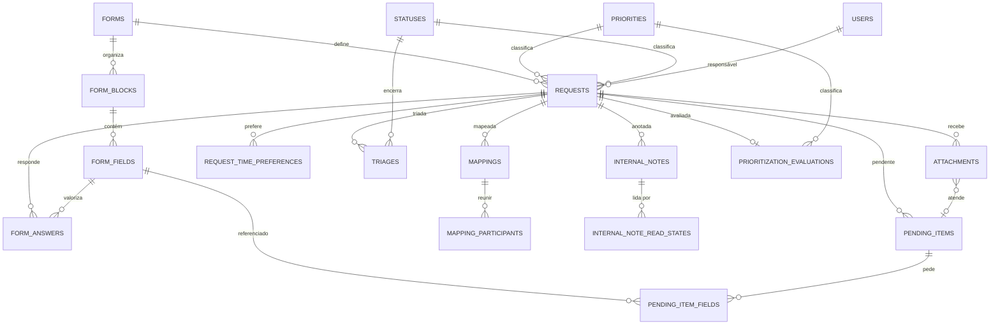
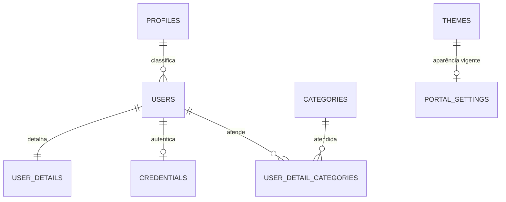
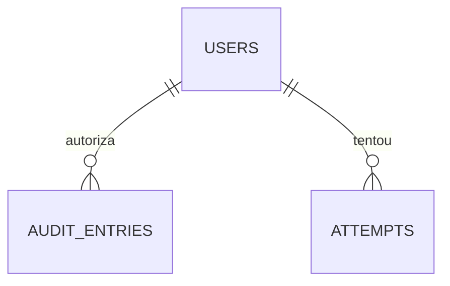

# Data Model

O modelo de dados do **MAAT** (Tirador de Pedidos): as tabelas, as colunas, as relações e as invariantes que a aplicação assume.

Este documento é **normativo**. A definição em Knex de cada domínio implementa o que está aqui; uma mudança de schema que não atualiza este documento é incompleta — ver [ADR-0010](./adr/0010-data-model-doc-is-the-spec.md). As convenções de nomenclatura e constraints estão em [ADR-0009](./adr/0009-schema-naming-and-constraints.md).

Documentos relacionados:

- [`01-Overview.md`](./01-Overview.md) — o sistema, o escopo, a stack.
- [`02-Architecture.md`](./02-Architecture.md) — camadas, injeção de dependências, persistência com Knex.
- [`../GLOSSARY.md`](../GLOSSARY.md) — vocabulário do domínio.
- [`adr/`](./adr/) — decisões de arquitetura registradas.

---

## 1. Scope and Source of Truth

O backend é organizado em treze domínios, cada um dono das suas tabelas ([ADR-0004](./adr/0004-domain-owned-schema-and-migrations.md)). Este documento descreve o schema completo: a soma das tabelas de cada domínio, mais a tabela de infraestrutura que não tem dono de domínio ([ADR-0011](./adr/0011-infrastructure-schema-without-domain-owner.md)).

O modelo é **novo**, escrito do zero: as migrations do legado são referência de dados e de regras, não de estrutura. Não há dado a migrar — o backend novo nasce com o banco vazio.

Três coisas convivem neste documento, e é útil saber qual é qual:

| Camada | Onde vive | Quem muda |
| --- | --- | --- |
| **Estrutura** — tabela, coluna, tipo, nulabilidade, constraint, índice | § 6 a § 18 deste documento | Domain owner, na definição em Knex do domínio |
| **Regras de negócio** — o que a coluna significa e que comportamento ela carrega | "Regras preservadas do legado" no fim de cada seção de domínio | Product + domain owner |
| **Decisões** — por que a estrutura é essa | [`adr/`](./adr/) | Architecture decision |

As regras de negócio **não** são inventadas aqui: o legado é a fonte de requisitos, e cada seção de domínio fecha com a lista do que a remodelagem preserva. Onde o legado tinha um defeito técnico — `ENUM` nativo, `btrim`, índice funcional, `CASCADE` — a estrutura muda e a regra não.

### 1.1 Inventário

28 tabelas em 13 domínios, mais 1 tabela de infraestrutura:

| Domínio | Tabelas | Escreve |
| --- | --- | --- |
| `auth` | `credentials` | `auth` |
| `users` | `profiles`, `users`, `user_details`, `user_detail_categories` | `users` |
| `requests` | `requests`, `form_answers`, `attachments`, `request_time_preferences` | `requests` |
| `triage` | `triages` | `triage` |
| `mapping` | `mappings`, `mapping_participants` | `mapping` |
| `queue` | — *(projeção de leitura)* | — |
| `prioritization` | `criteria`, `priorities`, `prioritization_evaluations` | `prioritization` |
| `pending-items` | `pending_items`, `pending_item_fields` | `pending-items` |
| `internal-notes` | `internal_notes`, `internal_note_read_states` | `internal-notes` |
| `audit` | `audit_entries`, `attempts` | `audit` |
| `reports` | — *(projeção de leitura)* | — |
| `portal-config` | `portal_settings`, `themes`, `categories`, `statuses` | `portal-config` |
| `forms` | `forms`, `form_blocks`, `form_fields` | `forms` |
| `platform` | `code_counters` | `platform` (infraestrutura) |

---

## 2. Naming Conventions

As regras valem para todas as tabelas deste documento. A justificativa de cada uma está em [ADR-0009](./adr/0009-schema-naming-and-constraints.md).

### 2.1 Tables

`snake_case`, no plural, em inglês, com o nome do domínio refletido no nome quando a tabela é específica dele (`internal_notes`, `mapping_participants`). Tabela que descreve um documento 1:1 com outro usa o nome do pai com o sufixo `_details` (`user_details`).

### 2.2 Columns

`snake_case`. Booleanos com prefixo `is_` ou `has_`, com as exceções registradas em [§ 2.6](#26-booleans).

Colunas de texto com limite de tamanho têm constraint `ck_` própria, nomeada `ck_<tabela>_<coluna>_length`. É a única forma de impor o limite nas três engines: o SQLite ignora o comprimento declarado em `varchar(n)`, e o `ck_` torna o limite explícito e uniforme em Postgres e MySQL. Onde a tabela deste documento escreve apenas "≤ N", o nome da constraint é o implícito acima.

Tabela que modela **uma instância** de um conceito repetível não prefixa as colunas com a instância: `themes` tem `background`, não `light_background` — a instância é a linha.

**Exceção: a chave de um campo de formulário é o contrato.** O valor de `form_fields.key` e de `form_blocks.key` é a chave que o frontend envia no payload (`processName`, `desiredDeadline`, `demand`), em camelCase. Não é snake_case porque não é nome interno: é a chave que liga a definição ao contrato da API, e o frontend valida contra ela.

**Uma chave promovida.** Uma chave do payload pode sair do formulário e ganhar uma **coluna própria, tipada e indexada** na entidade — é o que se chama de promover. Hoje há uma: `demand.category`, que é `requests.category_id`. Uma chave promovida deixa de ser pergunta e passa a ser atributo da entidade: o formulário deixa de perguntá-la, e o valor continua na coluna, que com NOT NULL e FK não pode ficar pendurada. Promover é uma operação: sai o campo da definição e nasce a coluna.

### 2.3 Primary Keys

Toda chave primária é `id`, UUID v4 gerado pela aplicação via porta `IdGenerator` ([ADR-0003](./adr/0003-knex-dialect-portability.md)). O schema não depende de `sequence`, `serial` ou `auto_increment`.

Duas exceções, ambas com chave natural ou composta, e nenhuma delas é um id sintético:

- **`code_counters`** usa `name` (text) como chave, porque a linha é identificada pelo nome do contador — é o que a porta `Counter` recebe.
- **`internal_note_read_states`** usa a PK composta (`request_id`, `user_id`), porque a marca de leitura é única por usuário e por solicitação.

A tabela singleton `portal_settings` usa `id` UUID como chave e é garantida pela aplicação e pelo seed — nenhuma constraint portable conta linhas.

### 2.4 Foreign Keys

Coluna nomeada `<entidade_no_singular>_id`, referenciando `id` da outra tabela. `ON DELETE RESTRICT` em todas.

**Quando a FK carrega o papel do ator**, o prefixo do papel vem antes do nome da entidade: `actor_user_id`, `author_user_id`, `created_by_user_id`, `responsible_id`, `assignee_user_id`, `calculated_by_user_id`, `resolved_by_user_id`, `updated_by_user_id`. A entidade alvo é sempre `users.id`.

**A entidade alvo é sempre a mesma para um dado par de nomes**: `forms.form_fields.id` é referenciada por `form_answers.field_id` e por `pending_item_fields.form_field_id` — as duas colunas dizem a mesma coisa em contextos diferentes.

A referência aponta para a **entidade**, nunca para a sua extensão 1:1. A identidade de uma pessoa é `users.id`; `user_details` é extensão de `users` e nunca é referenciada. A mesma regra vale para qualquer extensão 1:1 — `user_details` também é alcançada por `users.id`.

Relações com **naturalmente mais de uma origem** são polimórficas e **não têm FK** — é o caso de `audit_entries.entity_id`, que aponta para qualquer entidade auditável. A regra é a exceção, não o padrão.

### 2.5 Timestamps

| Tipo de linha | Colunas |
| --- | --- |
| Linha mutável | `created_at` e `updated_at` |
| Linha de evento | `occurred_at` (tempo de negócio, não ordem de commit) |
| Linha append-only | `created_at` apenas |

**Exceções de forma, já no modelo:** `attachments` registra `uploaded_at` (e não `created_at`); `internal_note_read_states` registra `read_at`; `code_counters` registra apenas `updated_at`; `priorities` é mutável por `is_active` e registra apenas `created_at`. O que vale para todas é o **tipo** único de timestamp.

Um único tipo de timestamp em toda a base, via `dialect.timestampType()`. `occurred_at` é tempo de negócio, não ordem de commit ([ADR-0007](./adr/0007-event-driven-audit.md)).

### 2.6 Booleans

Prefixo `is_` ou `has_`. Um "enum" de dois valores é boolean: `categories.status` (active/inactive) virou `categories.is_active`, e `user_details.status` virou `user_details.is_available`.

**Exceções, já no modelo:** `form_fields.required` e `form_fields.must_be_future` (o prefixo seria redundante com o nome do campo) e os tokens de Aparência `themes.logo_use_primary_color` e `themes.status_*_background_locked` (o prefixo quebraria o nome do token que o frontend consome).

### 2.7 Closed Value Sets

Cada conjunto fechado de valores é decidido por três testes, em ordem:

1. **Quem possui o vocabulário?** O código — o conjunto é enumerado e fixo no código → `text` com constraint `ck_` espelhando o catálogo do código, que é a fonte da verdade. O negócio — o conjunto cresce em tempo de execução → tabela de referência.
2. **É um estado que o código transiciona?** → coluna, nunca linha de referência.
3. **É um "enum" de dois valores?** → boolean.

O discriminante é **quem possui o vocabulário**, não quem edita a linha: um administrador que escolhe um `statuses.tone` não possui o conjunto de tons.

Há um caso misto: um conjunto com **dados de referência** e um rótulo enumerado — `priorities.level` é um rótulo de quatro níveis que o código conhece, e a tabela existe porque a faixa de score (`min_score`, `max_score`) é dado de referência administrável. Nesse caso o rótulo é coluna da tabela de referência, e a tabela existe pelo dado, não pelo rótulo.

Consequências:

- O mesmo conjunto não é armazenado duas vezes **como coluna de classificação**. Onde existe tabela de referência, o resto referencia por FK — `prioritization_evaluations.priority_id` substitui a cópia em texto da classificação. *Exceção:* o formulário tem campos `select` com opções inline que coincidem com um conjunto do produto (`perceivedCriticality` repete os quatro níveis de `priorities.level`); são vocabulários de formulário, não de classificação, e não têm FK porque o formulário é um catálogo genérico.
- Tabela de referência referenciada **pelo código** precisa de chave estável: `profiles.name` **é** a chave de `core/authorization/profile-permissions.ts`.
- Tabela de referência referenciada **por id** não precisa de chave estável: `statuses` usa `id` e `order_number`.
- Adicionar um valor a um vocabulário do código toca o catálogo **e** a constraint `ck_` no mesmo pull request. São espelhos; um PR que muda um sem o outro está quebrado.

### 2.8 Indexes and Constraints

| Prefixo | Objeto |
| --- | --- |
| `pk_` | chave primária |
| `fk_` | chave estrangeira |
| `uk_` | unicidade |
| `idx_` | índice |
| `ck_` | constraint de check |

O nome carrega a tabela: `ck_attachments_size_bytes`, `uk_requests_protocol`, `idx_requests_status_id`, `fk_mapping_participants_mapping_id`. A tabela entra no nome porque MySQL e SQLite escopam nomes de constraint por tabela e o Postgres por schema.

Constraints são declaradas com o construtor do knex (`table.check(predicate, undefined, "ck_nome")`), nunca com `ALTER TABLE` escrito à mão: `db.raw()` fora da porta `Dialect` é proibido ([ADR-0003](./adr/0003-knex-dialect-portability.md)).

Uma constraint de check **não enxerga outras linhas**. Invariante que depende de mais de uma linha — duas faixas de prioridade que não podem se sobrepor, por exemplo — é regra de aplicação e aparece listada como invariante na seção do domínio.

### 2.9 Text, Numbers and JSON

- Texto com limite: `text` + `ck_` de comprimento. Texto sem limite: `text`.
- Decimal com precisão explícita: `decimal(5,1)` para o score de priorização, `decimal(3,2)` para o peso padrão da faixa.
- JSON via `dialect.jsonType()`. A **forma** do JSON é validada na borda, com Zod ([02-Architecture § 13](./02-Architecture.md#13-validation-and-the-border)): `json_typeof()` é Postgres, e o equivalente diverge entre MySQL e SQLite.

### 2.10 Normalization

- **E-mail** é armazenado em minúsculas (`trim().toLowerCase()`) e único sobre o valor armazenado. O login normaliza antes de comparar.
- **Unicidade sem distinção de caixa** que não possa ser feita com `LOWER()` — porque índice funcional não é portátil — usa **coluna normalizada** mantida pela aplicação e única: `categories.normalized_name`.
- O e-mail do **solicitante** — a resposta de `requester.corporateEmail` — **não** é único, de propósito: mais de uma pessoa pode usar a mesma caixa corporativo. Não é um defeito. O e-mail da **conta** (`users.email`) é único.
- O e-mail do solicitante é **normalizado** como o da conta (`trim().toLowerCase()`), mesmo sem ser único — a busca por e-mail compara o valor normalizado.

### 2.11 Delete Policy

`ON DELETE RESTRICT` em todas as chaves estrangeiras. Não há `CASCADE` nem `SET NULL` em lugar nenhum do modelo.

A política é uma afirmação sobre o domínio: **nada é apagado**.

| Entidade | Como se retira |
| --- | --- |
| Solicitação | Encerrada (`closed_at`), nunca excluída |
| Usuário | Desativado (`users.is_active = false`), nunca excluído |
| Perfil, categoria, status, prioridade, critério | Desativado (`is_active = false`), nunca excluído |
| Nota interna, triagem, mapeamento, pendência, anexo | Não há rota de exclusão; a solicitação que os contém não é excluída |
| Formulário, bloco, campo | Desativado (`is_active = false`), nunca excluído: as respostas antigas continuam apontando para eles |

Esta tabela é a lista completa. Nenhuma seção de domínio repete a regra.

Por isso a exclusão de um status em uso é bloqueada pelo banco, e o caminho para retirá-lo é desativá-lo.

---

## 3. Vocabulary to Schema

O glossário é a fonte do vocabulário; estas são as tabelas onde cada termo vive.

| Termo (`GLOSSARY.md`) | Onde vive | Observação |
| --- | --- | --- |
| **Solicitação** | `requests.requests` | O registro e seu ciclo de vida |
| **Protocolo** | `requests.requests.protocol` | Identificador público, único, nunca reemitido |
| **Solicitante** | as respostas do bloco `requester` + `requests.requester_user_id` | Quem preencheu a solicitação; pode ser anônimo, e nesse caso não há conta |
| **Anexo** | `requests.attachments` | Vinculado à solicitação e, opcionalmente, a uma pendência |
| **Fila** | — | Projeção de leitura sobre `requests`; sem tabela própria |
| **Status** | `portal-config.statuses` | Etapa do ciclo de vida, com visibilidade pública ou interna |
| **Categoria** | `portal-config.categories`, `requests.category_id` | Classificação ordenável da solicitação — o solicitante propõe, a triagem confirma |
| **Prioridade** | `prioritization.priorities` | Faixa de criticidade, definida por faixa de score |
| **Triagem** | `triage.triages` | Histórico append-only; a triagem atual é a última linha |
| **Veredito** | `triage.triages.result` | Resultado da triagem |
| **Mapeamento** | `mapping.mappings` | Sessão de levantamento |
| **Análise de viabilidade** | — | Etapa do mapeamento; registrada em `mappings` e na auditoria, sem tabela própria |
| **Priorização** | `prioritization.prioritization_evaluations` | Cálculo da prioridade a partir de critérios ponderados |
| **Critério** | `prioritization.criteria` | Quesito ponderado, com peso ajustável |
| **Pendência** | `pending-items.pending_items` | Item que impede o avanço da solicitação |
| **Nota interna** | `internal-notes.internal_notes` | Registro imutável, integrado à linha do tempo |
| **Linha do tempo** | — | Projeção: `audit_entries` + `internal_notes` |
| **Auditoria** | `audit.audit_entries` | O que foi alterado, com autor, momento, valor anterior e novo |
| **Tentativa** | `audit.attempts` | O que foi recusado, gravado fora da transação |
| **Perfil** | `users.profiles` | Cinco perfis; permissões em código ([ADR-0006](./adr/0006-static-profile-authorization.md)) |
| **Admin Root** | `users.profiles` | Existe apenas no seed; nunca há auto-registro |
| **Responsável** | `requests.requests.responsible_id`, `triage.triages.assignee_user_id`, `mapping.mappings.responsible_id` | O Analista designado. São três colunas independentes: a da solicitação é o responsável **corrente** — é o que a custódia (o escopo das permissões, Apêndice B.1) considera; a da triagem e a do mapeamento congelam quem conduziu aquela etapa |
| **Modo de acesso** | `portal-config.portal_settings.solicitation_mode` | `PUBLIC` ou `AUTHENTICATED` |
| **Aparência** | `portal-config.themes` | Uma paleta do portal; as vigentes são as apontadas por `portal_settings` |
| **Formulário** | `forms.forms` | O que uma solicitação pede, definido por blocos e campos |
| **Bloco** | `forms.form_blocks` | Uma seção do formulário — identificação, demanda, operacional, complementar |
| **Campo** | `forms.form_fields` | Uma pergunta do formulário, com tipo, obrigatoriedade e limites |

---

## 4. Referential Integrity and Creation Order

Toda referência entre tabelas é uma FK com `ON DELETE RESTRICT`, inclusive entre domínios — **exceto as referências polimórficas** listadas no fim desta seção. A FK é declarada **na migration do domínio que referencia** e altera só a tabela que referencia: a [ADR-0004](./adr/0004-domain-owned-schema-and-migrations.md) proíbe alterar tabelas de dois domínios, não apontar para a tabela de outro.

Duas consequências operacionais:

**Ordem de criação.** A tabela referenciada precisa existir antes da que a referencia — se a ordem for invertida, a migration falha ao declarar a FK, porque a tabela referenciada ainda não existe. O knex ordena as migrations globalmente pelo prefixo de timestamp, então a ordem abaixo é a ordem dos timestamps das migrations:

| # | Domínio | Tabelas |
| --- | --- | --- |
| 1 | `users` | `profiles`, `users`, `user_details` |
| 2 | `forms` | `forms`, `form_blocks`, `form_fields` |
| 3 | `portal-config` | `statuses`, `categories`, `themes`, `portal_settings` |
| 4 | `users` | `user_detail_categories` |
| 5 | `prioritization` | `criteria`, `priorities` |
| 6 | `auth` | `credentials` |
| 7 | `requests` | `requests`, `form_answers`, `request_time_preferences` |
| 8 | `triage` | `triages` |
| 9 | `mapping` | `mappings`, `mapping_participants` |
| 10 | `pending-items` | `pending_items`, `pending_item_fields` |
| 11 | `requests` | `attachments` |
| 12 | `internal-notes` | `internal_notes`, `internal_note_read_states` |
| 13 | `prioritization` | `prioritization_evaluations` |
| 14 | `audit` | `audit_entries`, `attempts` |
| 15 | `platform` | `code_counters` |

**Desmontagem.** Renomear ou excluir uma tabela referenciada exige antes remover a FK que a aponta — e essa migration é do domínio que referencia. É o único ponto em que a autonomy de um domínio toca a de outro, e ele é explícito.

**Exceções ao padrão.** Três colunas não têm FK:

| Relação | Por quê |
| --- | --- |
| `audit_entries.entity_id` → qualquer entidade | Referência polimórfica por natureza |
| `attempts.entity_id` → qualquer entidade | Referência polimórfica por natureza |
| `audit_entries.entity_type` / `action_type` | Vocabulário do código, espelhado em `ck_` |

---

## 5. Entity-Relationship Overview

Diagramas de orientação: mostram como os domínios se conectam, não cada chave estrangeira. A relação completa está na coluna `FK →` de cada tabela, e a ordem de criação em [§ 4](#4-referential-integrity-and-creation-order).

### 5.1 The Request Cycle

### 5.2 Access and Configuration

### 5.3 Audit

## 6. Domain `auth`

Responsabilidade: login, logout, sessão, troca de senha. Publica a porta `AuthReader`. É o único domínio que enxerga material de senha.

### 6.1 `credentials`

Material de credencial do usuário. Separado de `users` para que o domínio `users` nunca segure segredo: `UserReader` não pode vazar hash, e nenhuma listagem de usuários precisa se lembrar de excluir uma coluna.

| Coluna | Tipo | Nulo | Default | Notas |
| --- | --- | --- | --- | --- |
| `id` | uuid | não | — | PK, UUID v4 gerado pela aplicação |
| `user_id` | uuid | não | — | FK → `users.id`, UNIQUE `uk_credentials_user_id` |
| `password_hash` | text | não | — | `ck_credentials_password_hash_length` ≤ 255 |
| `password_changed_at` | timestamp | não | `now` | Época de revogação dos tokens |
| `must_change_password` | boolean | não | `true` | Trava todas as rotas exceto `/auth/me` e `/auth/change-password` |
| `created_at` | timestamp | não | `now` | Sem `updated_at`: a única mutação é a troca de senha, já marcada em `password_changed_at` |

**Índices** — `uk_credentials_user_id` (único).

**Invariantes**

- Uma credencial por usuário, e todo usuário tem credencial. `Admin Root` é criado no seed.
- O hash é bcrypt (`$2b$10$…`): algoritmo e custo estão na própria string, então trocar de algoritmo não exige migration.
- `password_changed_at` nunca anda para trás. Um token emitido antes do valor atual é recusado — é o mecanismo de revogação.
- A senha nunca é armazenada; só o hash. A resposta de login é idêntica para e-mail inexistente, conta inativa e senha errada.
- **Não existe tabela de sessões.** A sessão é o token: JWT em cookie `HttpOnly`, relido do banco a cada requisição ([02-Architecture § 14.1](./02-Architecture.md#141-session)). Logout encerra o cookie; a janela de exposição é o TTL. Desativar a conta ou trocar a senha invalida todos os tokens emitidos.

**Regras preservadas do legado**

- Resposta única de login — "credenciais inválidas" — para e-mail inexistente, conta inativa, perfil inativo e senha errada, com comparação de tempo uniforme (hash de mentira quando o usuário não existe).
- `must_change_password` bloqueia tudo, exceto a própria troca e a consulta de sessão; a resposta é 403.
- Senha temporária gerada por CSPRNG, com 14 caracteres, exibida uma única vez ao administrador, e que obriga a troca.
- Troca de senha exige a senha atual e proíbe que a nova seja igual à atual.
- A troca de senha grava o registro de auditoria **na mesma transação**; se a auditoria falhar, a troca é desfeita ([ADR-0007](./adr/0007-event-driven-audit.md)).

---

## 7. Domain `users`

Responsabilidade: cadastro, perfil, dados do usuário, avatar. Publica a porta `UserReader`. As permissões são uma matriz em código ([ADR-0006](./adr/0006-static-profile-authorization.md)); o banco guarda **quem é** cada perfil, não **o que ele pode**.

### 7.1 `profiles`

Os cinco perfis do produto. `name` é a chave estável: é o mesmo valor usado em `core/authorization/profile-permissions.ts`.

| Coluna | Tipo | Nulo | Default | Notas |
| --- | --- | --- | --- | --- |
| `id` | uuid | não | — | PK, UUID v4 |
| `name` | text | não | — | UNIQUE `uk_profiles_name`. Valores: `Solicitante`, `Analista`, `Gestor`, `Administrador`, `Admin Root` |
| `is_active` | boolean | não | `true` | Perfil desativado impede o acesso de todos os usuários daquele perfil |
| `created_at` | timestamp | não | `now` | |
| `updated_at` | timestamp | não | `now` | |

**Relações** — `users.profile_id` → `profiles.id` (RESTRICT).

**Índices** — `uk_profiles_name`.

**Invariantes**

- As linhas semeadas são exatamente as chaves do catálogo de permissões em código. Divergência entre o seed e a matriz é um bug de autorização silencioso.
- `Admin Root` existe apenas no seed. Não há auto-registro.

### 7.2 `users`

A conta. Não carrega material de senha — esse é do domínio `auth`.

| Coluna | Tipo | Nulo | Default | Notas |
| --- | --- | --- | --- | --- |
| `id` | uuid | não | — | PK, UUID v4 |
| `name` | text | não | — | `ck_users_name_length` ≤ 150 |
| `email` | text | não | — | UNIQUE `uk_users_email`, `ck_users_email_length` ≤ 254, armazenado em minúsculas |
| `profile_id` | uuid | não | — | FK → `profiles.id` (RESTRICT) |
| `area` | text | sim | — | `ck_users_area_length` ≤ 100 — área do usuário |
| `department` | text | sim | — | `ck_users_department_length` ≤ 100 |
| `manager_name` | text | sim | — | `ck_users_manager_name_length` ≤ 150 |
| `additional_contact` | text | sim | — | `ck_users_additional_contact_length` ≤ 100 |
| `is_active` | boolean | não | `true` | Desativar a conta invalida todos os tokens imediatamente |
| `avatar_url` | text | sim | — | `ck_users_avatar_url_length` ≤ 500 |
| `created_at` | timestamp | não | `now` | |
| `updated_at` | timestamp | não | `now` | |

**Índices** — `uk_users_email`.

**Invariantes**

- O e-mail é armazenado normalizado e único sobre o valor armazenado. E-mails que diferem só por caixa são o mesmo e-mail.
- A conta guarda a **própria cópia** de contato — área, departamento, gestor e contato adicional. O que a solicitação carrega é uma resposta, e não esta cópia ([ADR-0013](./adr/0013-requester-is-an-answer-not-a-table.md)).
- O token **não** carrega o perfil como autoridade: o middleware relê usuário e perfil do banco a cada requisição ([02-Architecture § 14.1](./02-Architecture.md#141-session)). Desativação e mudança de perfil valem na hora.
- Usuário não é excluído. Desativar é o caminho de retirada.

### 7.3 `user_details`

Dados adicionais do usuário interno: cargo, especialidades, áreas atendidas, disponibilidade. É a extensão 1:1 de `users`.

| Coluna | Tipo | Nulo | Default | Notas |
| --- | --- | --- | --- | --- |
| `id` | uuid | não | — | PK, UUID v4 |
| `user_id` | uuid | não | — | FK → `users.id`, UNIQUE `uk_user_details_user` |
| `job_title` | text | sim | — | `ck_user_details_job_title_length` ≤ 100 |
| `specialties` | text | sim | — | Texto livre |
| `is_available` | boolean | não | `true` | Disponibilidade do profissional — **não** é a conta |
| `capacity` | integer | não | `5` | `ck_user_details_capacity_non_negative` ≥ 0 |
| `notes` | text | sim | — | |
| `created_at` | timestamp | não | `now` | |
| `updated_at` | timestamp | não | `now` | |

**Índices** — `uk_user_details_user`.

**Invariantes**

- Um `user_details` por usuário, no máximo.
- `is_available` e `users.is_active` são coisas diferentes: a conta pode estar ativa e o profissional indisponível. Só `users.is_active` derruba token.

### 7.4 `user_detail_categories`

Áreas atendidas pelo usuário interno. Tabela filha, e não coluna `ARRAY` ou texto com ids ([02-Architecture § 10.3](./02-Architecture.md#103-portability-rules)). Aponta para `users.id` — a identidade do profissional é a conta, e não a extensão 1:1.

| Coluna | Tipo | Nulo | Default | Notas |
| --- | --- | --- | --- | --- |
| `id` | uuid | não | — | PK, UUID v4 |
| `user_id` | uuid | não | — | FK → `users.id` (RESTRICT) |
| `category_id` | uuid | não | — | FK → `portal-config.categories.id` (RESTRICT) |

**Índices** — UNIQUE `uk_user_detail_categories_user_category` (`user_id`, `category_id`).

**Invariantes**

- A mesma categoria não é atendida duas vezes pelo mesmo usuário.
- Quem atende categorias tem extensão: uma linha em `user_detail_categories` pressupõe a linha correspondente em `user_details`, criada na mesma transação. É regra de aplicação — uma constraint de check não enxerga outras linhas.

**Regras preservadas do legado**

- Um profissional atende a um conjunto de categorias; a lista era uma coluna de texto com ids e virou tabela filha.
- Usuário e perfil têm documento próprio de dados (cargo, especialidades, disponibilidade, capacidade).

---

## 8. Domain `requests`

Responsabilidade: ciclo de vida da solicitação, protocolo, anexos. Publica a porta `RequestReader`.

O **conteúdo** da solicitação não mora nesta tabela: o solicitante preenche um **formulário**, e cada resposta é uma linha de `form_answers`. A definição do formulário vem do domínio `forms`. A tabela `requests` guarda identidade, classificação de fluxo, ciclo de vida e o que é publicado ao solicitante.

### 8.1 `requests`

| Coluna | Tipo | Nulo | Default | Notas |
| --- | --- | --- | --- | --- |
| `id` | uuid | não | — | PK, UUID v4 |
| `protocol` | text | não | — | UNIQUE `uk_requests_protocol`, `ck_requests_protocol_length` ≤ 25 |
| `form_id` | uuid | não | — | FK → `forms.forms.id` (RESTRICT) — o formulário respondido |
| `requester_user_id` | uuid | sim | — | FK → `users.id` (RESTRICT) — nulo quando a solicitação é anônima |
| `status_id` | uuid | não | — | FK → `portal-config.statuses.id` (RESTRICT) — status interno atual |
| `category_id` | uuid | não | — | FK → `portal-config.categories.id` (RESTRICT) — a classificação da solicitação |
| `last_public_status_id` | uuid | sim | — | FK → `portal-config.statuses.id` (RESTRICT) — último status visível ao solicitante |
| `priority_id` | uuid | sim | — | FK → `prioritization.priorities.id` (RESTRICT) |
| `responsible_id` | uuid | sim | — | FK → `users.id` (RESTRICT) — o Responsável |
| `estimated_completion` | date | sim | — | Data estimada de conclusão |
| `meeting_scheduled_for` | timestamp | sim | — | Reunião combinada, publicada ao solicitante |
| `meeting_link` | text | sim | — | `ck_requests_meeting_link_length` ≤ 500 |
| `last_technical_message` | text | sim | — | Última mensagem técnica publicada |
| `last_external_update_at` | timestamp | sim | — | Última atualização feita pelo solicitante |
| `closed_at` | timestamp | sim | — | Momento do encerramento |
| `created_by` | text | não | — | `ck_requests_created_by_length` ≤ 100 — rótulo de quem abriu |
| `created_by_user_id` | uuid | sim | — | FK → `users.id` (RESTRICT) — nulo quando o registro é do portal público |
| `created_at` | timestamp | não | `now` | |
| `updated_at` | timestamp | não | `now` | |

**Relações** — `form_id` → `forms.forms.id`; `requester_user_id` → `users.id`; `status_id` e `last_public_status_id` → `portal-config.statuses.id`; `category_id` → `portal-config.categories.id`; `priority_id` → `prioritization.priorities.id`; `responsible_id` → `users.id`; `created_by_user_id` → `users.id`.

**Índices** — UNIQUE `uk_requests_protocol`; `idx_requests_status_id`; `idx_requests_category_id`; `idx_requests_requester_user_id`; `idx_requests_priority_id`; `idx_requests_responsible_id`; `idx_requests_created_at`.

**Invariantes**

- O protocolo é produzido pelo contador (`code_counters`), nunca reemitido, e único por constraint — belt-and-braces sobre a bijeção da cifra ([ADR-0008](./adr/0008-protocol-without-collision-risk.md)). A leitura por protocolo **nunca** usa `.first()`: é uma sondagem com `LIMIT 2` que falha explicitamente se duas linhas corresponderem.
- `last_public_status_id` nunca está à frente de `status_id`: quando o status interno é restrito, o solicitante continua vendo o último status público. É assim que a solicitação é encerrada para o solicitante sem revelar o trâmite interno.
- `closed_at` é gravado na mesma transação da mudança de status que entra num status terminal (`statuses.is_terminal`), e é zerado se a solicitação volta a um status não terminal.
- O solicitante pode ser anônimo: `requester_user_id` é nulo e a identidade do solicitante está nas respostas do bloco `requester`.
- `created_by` é um rótulo, não uma referência — o portal público não tem usuário. `created_by_user_id` é a referência quando existe.
- A solicitação não é excluída.
- **A categoria é uma classificação, não uma pergunta.** É uma coluna — `requests.category_id` — e não um campo do formulário, porque status, prioridade e categoria são as três classificações da solicitação: as três são lidas pela fila, pelo dashboard e pela exportação, e as três são colunas tipadas. Ver [ADR-0012](./adr/0012-form-is-a-configurable-entity.md).
- **O formulário só pergunta o que não é classificação.** A customização adiciona e remove perguntas; ela não toca nas classificações. Uma chave promovida deixa de ser perguntada, e o valor continua na coluna — que, com NOT NULL e FK, não pode ficar pendurada.
- **A categoria chega pelo payload e é resolvida na escrita.** O frontend manda `demand.category` com o **nome** escolhido; o backend resolve o nome contra as categorias ativas e grava o `id`. Nome inválido é 400.
- **Quem reescreve a classificação:** a equipe, quando a triagem reclassifica — é a exceção que a regra da pendência permite. A correção pedida pelo solicitante é por pendência, e a pendência não edita a solicitação.

**Regras preservadas do legado**

- O protocolo é público, curto e não enumerável, e permite ao solicitante acompanhar a solicitação sem expor identidade interna.
- O solicitante acompanha pelo protocolo; no modo público, a checagem de dono é feita pelo serviço.
- A solicitação guarda data estimada de conclusão, reunião combinada e última mensagem técnica — o que o portal publica ao solicitante.
- A abertura no modo autenticado ignora o nome e o e-mail do payload e usa os da sessão.

### 8.2 `form_answers`

As respostas do solicitante. Uma linha por campo preenchido.

| Coluna | Tipo | Nulo | Default | Notas |
| --- | --- | --- | --- | --- |
| `id` | uuid | não | — | PK, UUID v4 |
| `request_id` | uuid | não | — | FK → `requests.id` (RESTRICT) |
| `field_id` | uuid | não | — | FK → `forms.form_fields.id` (RESTRICT) |
| `value_text` | text | sim | — | Texto, e-mail, ou o **valor** da opção de um `select` — `ck_form_answers_value_text_length` ≤ 8000 |
| `value_number` | decimal | sim | — | Números e decimais |
| `value_date` | date | sim | — | Datas |
| `value_boolean` | boolean | sim | — | Booleanos |
| `value_json` | json | sim | — | Valores estruturados |
| `created_at` | timestamp | não | `now` | |

**Relações** — `request_id` → `requests.id`; `field_id` → `forms.form_fields.id` (domínio `forms`).

**Índices** — UNIQUE `uk_form_answers_request_field` (`request_id`, `field_id`); `idx_form_answers_field_request` (`field_id`, `request_id`); `idx_form_answers_field_text` (`field_id`, `value_text`).

**Invariantes**

- Uma resposta por campo de uma solicitação.
- A coluna de valor é determinada pelo tipo do campo: `text`, `long_text`, `email` e `select` → `value_text`; `number` e `decimal` → `value_number`; `date` → `value_date`; `boolean` → `value_boolean`; `yes_no_detail` → `value_boolean` **e** `value_text` (o detalhe). `value_json` fica para valor estruturado.
- `value_text` só pode coexistir com `value_boolean`; qualquer outra combinação de duas colunas preenchidas é rejeitada por `ck_form_answers_value_shape`.
- As respostas de uma solicitação pertencem ao formulário em `requests.form_id`.
- O valor de um `select` é o **valor** da opção, não o rótulo. As opções inline de um `select` são strings do próprio contrato.
- **O banco não impõe os limites do campo.** O limite mora na definição (`form_fields.max_length`, `min_value`, `max_value`) e o valor em outra linha: a validação é da aplicação, na borda, guiada pela definição.
- **`ck_form_answers_value_text_length` é um piso da tabela, não o limite do campo.** Ele limita o tamanho de qualquer resposta de texto, sem saber a qual campo ela pertence — o limite de 8000 é o dobro do maior limite de campo hoje (4000), e um campo que precise de mais exige uma migration para levantar o piso. Ele não substitui a validação da aplicação: um campo com `max_length` 150 continua aceitando mais, se a borda não validar.
- Corrigir um campo reescreve a resposta; o histórico fica na auditoria.

**Regras preservadas do legado**

- O formulário é o mesmo: os quatro blocos, os campos, as obrigatoriedades e os limites.
- A categoria é validada contra as categorias ativas no momento da abertura, e gravada como coluna — não como resposta.

### 8.3 `attachments`

Arquivos enviados com a solicitação.

| Coluna | Tipo | Nulo | Default | Notas |
| --- | --- | --- | --- | --- |
| `id` | uuid | não | — | PK, UUID v4 |
| `request_id` | uuid | não | — | FK → `requests.id` (RESTRICT) |
| `pending_item_id` | uuid | sim | — | FK → `pending-items.pending_items.id` (RESTRICT) |
| `file_name` | text | não | — | ≤ 255 |
| `file_path` | text | não | — | ≤ 1000 — caminho do arquivo no armazenamento |
| `content_type` | text | não | — | `ck_attachments_content_type` ∈ `application/pdf`, `application/vnd.openxmlformats-officedocument.wordprocessingml.document`, `application/vnd.openxmlformats-officedocument.spreadsheetml.sheet`, `image/png`, `image/jpeg` |
| `size_bytes` | integer | não | — | `ck_attachments_size_bytes` > 0 e ≤ 10485760 |
| `is_restricted` | boolean | não | `false` | Anexo de conteúdo restrito |
| `uploaded_by` | text | não | — | ≤ 100 |
| `uploaded_at` | timestamp | não | `now` | |

**Índices** — `idx_attachments_request_id`; `idx_attachments_pending_item_id`; `idx_attachments_is_restricted`.

**Invariantes**

- O arquivo vive fora do banco; a tabela guarda o ponteiro, o tamanho e o tipo.
- `pending_item_id` liga o anexo à pendência que ele atende.
- No máximo cinco anexos por solicitação, e no máximo dez megabytes por arquivo.

### 8.4 `request_time_preferences`

Slots de horário que o solicitante marcou como preferência.

| Coluna | Tipo | Nulo | Default | Notas |
| --- | --- | --- | --- | --- |
| `id` | uuid | não | — | PK, UUID v4 |
| `request_id` | uuid | não | — | FK → `requests.id` (RESTRICT) |
| `scheduled_for` | timestamp | não | — | Mesmo tipo de timestamp do resto da base |
| `created_at` | timestamp | não | `now` | |

**Índices** — UNIQUE `uk_request_time_preferences_slot` (`request_id`, `scheduled_for`).

**Invariantes**

- O mesmo slot não é registrado duas vezes para a mesma solicitação.
- No máximo três slots por solicitação, e todos no futuro ou no dia de hoje.

## 9. Domain `triage`

Responsabilidade: triagem — aderência, escopo, veredito. Publica a porta `TriageReader`.

### 9.1 `triages`

Histórico de triagens. Cada triagem é uma linha nova; a triagem atual é a última.

| Coluna | Tipo | Nulo | Default | Notas |
| --- | --- | --- | --- | --- |
| `id` | uuid | não | — | PK, UUID v4 |
| `request_id` | uuid | não | — | FK → `requests.id` (RESTRICT) |
| `adherent_to_scope` | text | não | — | `ck_triages_adherent_to_scope` ∈ `Sim`, `Não`, `` |
| `adherent_justification` | text | não | `` | Justificativa da aderência |
| `change_category` | text | não | — | `ck_triages_change_category` ∈ `Sim`, `Não`, `` |
| `new_category` | text | não | `` | ≤ 40 — categoria proposta quando a triagem muda a classificação |
| `preliminary_complexity` | text | não | `` | |
| `perceived_risks` | text | não | `` | |
| `suggested_responsible` | text | não | `` | ≤ 150 — **texto livre**, é sugestão, não vínculo |
| `suggested_responsible_justification` | text | não | `` | |
| `assignee_user_id` | uuid | sim | — | FK → `users.id` (RESTRICT) — o Responsável designado |
| `assignee_name` | text | sim | — | Rótulo do responsável no momento da triagem |
| `assignee_email` | text | sim | — | E-mail do responsável no momento da triagem |
| `exit_status_id` | uuid | não | — | FK → `portal-config.statuses.id` (RESTRICT) — status de saída da triagem |
| `result` | text | não | — | `ck_triages_result` ∈ `elegível`, `pendente de informações`, `fora do escopo`, `direcionada para outra área`, `duplicada`, `cancelada`, `backlog` — o Veredito; ≤ 1000 |
| `conclusion_justification` | text | não | — | |
| `last_technical_message` | text | sim | — | Mensagem técnica associada |
| `author_user_id` | uuid | não | — | FK → `users.id` (RESTRICT) — quem triou |
| `occurred_at` | timestamp | não | `now` | Tempo de negócio, não ordem de commit |

**Relações** — `request_id` → `requests.id`; `exit_status_id` → `portal-config.statuses.id`; `assignee_user_id` e `author_user_id` → `users.id`.

**Índices** — `idx_triages_request_id_occurred_at` (`request_id`, `occurred_at`).

**Invariantes**

- `triages` é a **única** casa do resultado da triagem. A solicitação não tem cópia de triagem: as colunas de triagem que existiam em `requests` no legado foram removidas.
- A triagem é append-only: corrigir uma triagem é registrar outra linha.
- `suggested_responsible` é texto livre — a triagem sugere um nome. O vínculo é `assignee_user_id`, e é o responsável efetivo. O rótulo e o e-mail congelam quem era o responsável no momento.
- `occurred_at` ordena a linha do tempo da triagem por tempo de negócio.

**Regras preservadas do legado**

- A triagem registra aderência ao escopo, mudança de categoria, complexidade preliminar, riscos percebidos, responsável sugerido com justificativa, status de saída e resultado com justificativa.
- O resultado é o Veredito: elegível, pendente de informações, fora do escopo, direcionada, duplicada, cancelada ou backlog.
- A proveniência (ator, momento, origem) fica na auditoria; a linha carrega o próprio autor e o próprio tempo para ser legível sem JOIN.

---

## 10. Domain `mapping`

Responsabilidade: sessão de mapeamento, participantes, agenda. Publica a porta `MappingReader`.

### 10.1 `mappings`

| Coluna | Tipo | Nulo | Default | Notas |
| --- | --- | --- | --- | --- |
| `id` | uuid | não | — | PK, UUID v4 |
| `request_id` | uuid | não | — | FK → `requests.id` (RESTRICT) |
| `responsible_id` | uuid | sim | — | FK → `users.id` (RESTRICT) — o Analista conduz o mapeamento |
| `scheduled_for` | timestamp | sim | — | ISO-8601 com offset, persistido em UTC |
| `duration_minutes` | integer | sim | — | `ck_mappings_duration_minutes` ≥ 15 e ≤ 480 |
| `modality` | text | sim | — | `ck_mappings_modality` ∈ `REMOTE`, `IN_PERSON` |
| `meeting_link` | text | sim | — | ≤ 500 |
| `location` | text | sim | — | ≤ 500 |
| `notes` | text | sim | — | ≤ 2000 |
| `justification` | text | sim | — | Justificativa da transição |
| `last_technical_message` | text | sim | — | Mensagem técnica associada |
| `target_status_id` | uuid | sim | — | FK → `portal-config.statuses.id` (RESTRICT) — status de destino do mapeamento |
| `is_concluded` | boolean | não | `false` | |
| `concluded_at` | timestamp | sim | — | |
| `created_by_user_id` | uuid | não | — | FK → `users.id` (RESTRICT) |
| `created_at` | timestamp | não | `now` | |
| `updated_by_user_id` | uuid | sim | — | FK → `users.id` (RESTRICT) |
| `updated_at` | timestamp | sim | — | |

**Índices** — `idx_mappings_request_id`; `idx_mappings_request_id_is_concluded`.

**Invariantes**

- Uma solicitação pode ter vários mapeamentos, mas **no máximo um aberto** — o mapeamento atual é o mais recente não concluído. A unicidade é da aplicação, garantida na transação que conclui o anterior.
- `scheduled_for` é persistido em UTC e devolvido com `Z`.
- A duração, quando informada, está entre 15 e 480 minutos.

### 10.2 `mapping_participants`

Participantes do mapeamento: internos (ligados a uma conta) ou externos (nome e e-mail informados na hora).

| Coluna | Tipo | Nulo | Default | Notas |
| --- | --- | --- | --- | --- |
| `id` | uuid | não | — | PK, UUID v4 |
| `mapping_id` | uuid | não | — | FK → `mappings.id` (RESTRICT) |
| `user_id` | uuid | sim | — | FK → `users.id` (RESTRICT) — participante interno |
| `name` | text | sim | — | ≤ 255 |
| `email` | text | sim | — | ≤ 255 — armazenado em minúsculas |
| `created_at` | timestamp | não | `now` | |

**Índices** — UNIQUE `uk_mapping_participants_user` (`mapping_id`, `user_id`); UNIQUE `uk_mapping_participants_email` (`mapping_id`, `email`).

**Invariantes**

- O mesmo usuário não aparece duas vezes no mesmo mapeamento. Participantes externos têm `user_id` nulo, e nulos não colidem entre si — vários externos são permitidos.
- A unicidade por e-mail é case-insensitive sem índice funcional: o e-mail é normalizado na gravação e a unicidade é sobre o valor armazenado.

**Regras preservadas do legado**

- O mapeamento tem data, duração, modalidade, link, local e notas; e pode ser concluído, com registro de conclusão.
- Participante interno vem do cadastro; participante externo vem do payload, com nome e e-mail.

---

## 11. Domain `queue`

Responsabilidade: fila centralizada e métricas. **Não tem tabelas** — é uma projeção de leitura sobre `requests` e as tabelas de configuração, e consome as portas publicadas por outros domínios ([02-Architecture § 5](./02-Architecture.md#5-domain-catalog)).

A ordenação da fila é **derivada**, nunca armazenada: `categories.display_order` ordena o card, `statuses.order_number` ordena a etapa, `prioritization.priorities.min_score` ordena a prioridade. Não existe coluna de ordenação em `requests` — ela envelheceria e passaria a discordar da configuração.

A projeção consome: `requests.requests`, `requests.form_answers`, `forms.form_fields`, `portal-config.statuses`, `portal-config.categories`, `prioritization.priorities`, `users.users`. O nome do solicitante, o processo e o prazo saem das respostas — a fila os lê por chave de campo.

---

## 12. Domain `prioritization`

Responsabilidade: critérios, pesos e a Prioridade resultante. Publica a porta `PrioritizationReader`.

### 12.1 `criteria`

Quesitos ponderados do cálculo.

| Coluna | Tipo | Nulo | Default | Notas |
| --- | --- | --- | --- | --- |
| `id` | uuid | não | — | PK, UUID v4 |
| `code` | text | não | — | UNIQUE `uk_criteria_code` ≤ 50 — o identificador estável do critério |
| `name` | text | não | — | ≤ 100 |
| `weight` | integer | não | — | `ck_criteria_weight_positive` > 0 |
| `is_active` | boolean | não | `true` | Critério desativado sai do cálculo |
| `display_order` | integer | não | — | |
| `created_at` | timestamp | não | `now` | |
| `updated_at` | timestamp | não | `now` | |

**Índices** — UNIQUE `uk_criteria_code`.

**Invariantes**

- O peso é positivo. Critério desativado não participa do cálculo, mas mantém a linha e o histórico.

### 12.2 `priorities`

Faixas de criticidade. A faixa é definida por faixa de score — por isso a tabela mora no domínio da priorização, e não no de configuração do portal.

| Coluna | Tipo | Nulo | Default | Notas |
| --- | --- | --- | --- | --- |
| `id` | uuid | não | — | PK, UUID v4 |
| `level` | text | não | — | UNIQUE `uk_priorities_level` ≤ 50 — `Baixa`, `Média`, `Alta`, `Crítica` |
| `min_score` | integer | não | — | `ck_priorities_score_range` — `min_score` ≤ `max_score` |
| `max_score` | integer | não | — | |
| `default_weight` | decimal | não | — | `decimal(3,2)` — peso padrão da faixa |
| `color_code` | text | sim | — | ≤ 50 |
| `description` | text | sim | — | |
| `is_active` | boolean | não | `true` | Faixa desativada sai da classificação |
| `created_at` | timestamp | não | `now` | |

**Índices** — UNIQUE `uk_priorities_level`.

**Invariantes**

- `min_score` ≤ `max_score`, garantido por constraint.
- A tabela existe pelo **dado de referência** — a faixa de score e o peso padrão, administráveis — e não pelo rótulo: `level` é um dos quatro níveis que o código conhece.
- **As faixas não podem se sobrepor.** Uma constraint de check não enxerga outras linhas: a não sobreposição é regra de aplicação, verificada quando a faixa é salva.

### 12.3 `prioritization_evaluations`

A avaliação corrente da solicitação. O histórico de reavaliações **não** tem tabela própria: fica na auditoria ([ADR-0007](./adr/0007-event-driven-audit.md)) — estado atual na entidade, trilha imutável na auditoria.

| Coluna | Tipo | Nulo | Default | Notas |
| --- | --- | --- | --- | --- |
| `id` | uuid | não | — | PK, UUID v4 |
| `request_id` | uuid | não | — | FK → `requests.id` (RESTRICT), UNIQUE `uk_prioritization_evaluations_request_id` |
| `notes` | json | não | — | Snapshot das notas do cálculo — um objeto |
| `score` | decimal | não | — | `decimal(5,1)`, `ck_prioritization_evaluations_score_range` ≥ 10 e ≤ 50 |
| `priority_id` | uuid | não | — | FK → `priorities.id` (RESTRICT) — a faixa resultante |
| `calculated_by_user_id` | uuid | não | — | FK → `users.id` (RESTRICT) |
| `calculated_at` | timestamp | não | `now` | |
| `created_at` | timestamp | não | `now` | |
| `updated_at` | timestamp | não | `now` | |

**Índices** — UNIQUE `uk_prioritization_evaluations_request_id`.

**Invariantes**

- Uma avaliação corrente por solicitação.
- A faixa resultante é uma referência à tabela de faixas, não uma cópia do texto. O legado guardava a classificação como `ENUM` duplicado aqui.
- A forma do `notes` — um objeto — é validada na borda com Zod; o banco valida só o que é portátil.

**Regras preservadas do legado**

- O score é normalizado na faixa 10–50, e a classificação sai das faixas configuradas.
- As notas do cálculo são um snapshot, não uma referência.
- Reavaliar substitui a avaliação corrente; o histórico fica na trilha de auditoria.

---

## 13. Domain `pending-items`

Responsabilidade: pendências de campo e de observação. Publica a porta `PendingItemReader`.

### 13.1 `pending_items`

| Coluna | Tipo | Nulo | Default | Notas |
| --- | --- | --- | --- | --- |
| `id` | uuid | não | — | PK, UUID v4 |
| `request_id` | uuid | não | — | FK → `requests.id` (RESTRICT) |
| `type` | text | não | — | `ck_pending_items_type` ∈ `field_edit`, `attachment_upload`, `information`, `action` |
| `description` | text | não | — | |
| `requested_fields` | json | sim | — | **Chaves** de campo solicitadas (`"processName"`), quando o tipo é `field_edit` — o par json de `pending_item_fields`, que guarda os **ids** dos campos |
| `requires_attachment` | boolean | não | `false` | |
| `expected_attachment_type` | text | sim | — | ≤ 100 |
| `is_visible_to_requester` | boolean | não | `true` | |
| `status` | text | não | `open` | `ck_pending_items_status` ∈ `open`, `resolved` |
| `deadline` | date | sim | — | |
| `resolution` | text | sim | — | Texto da resolução |
| `resolved_by_user_id` | uuid | sim | — | FK → `users.id` (RESTRICT) |
| `resolved_at` | timestamp | sim | — | |
| `created_by_user_id` | uuid | não | — | FK → `users.id` (RESTRICT) |
| `created_at` | timestamp | não | `now` | |

**Índices** — `idx_pending_items_request_id`; `idx_pending_items_status`; `idx_pending_items_is_visible_to_requester`.

**Invariantes**

- **A pendência tem dois estados: `open` e `resolved`.** `overdue` não é estado armazenado — é derivado de `deadline`. O legado nunca gravou `overdue`; a fila e os relatórios calculam atraso em consulta.
- A resolução fica na própria pendência: uma pendência resolvida é uma pendência com `resolution`, `resolved_by_user_id` e `resolved_at`. Não há histórico de respostas.
- `requested_fields` só faz sentido para `type = field_edit`. Ele guarda as **chaves** do contrato, e `pending_item_fields` guarda os **ids** dos campos: as duas representações não são intercambiáveis. **A tabela filha é a fonte autoritativa**; o json é derivado dela e é regenerado quando a pendência é gravada.
- Pendência pode pedir correção de um campo ou apenas registrar uma observação — `type` distingue os dois casos.
- **Uma pendência pede a correção de um campo do formulário.** A classificação da solicitação não é campo: a categoria é corrigida pela equipe, na triagem.

### 13.2 `pending_item_fields`

Os campos que a pendência pede para corrigir. O legado guardava as chaves em um json; aqui elas são referência ao campo do formulário.

| Coluna | Tipo | Nulo | Default | Notas |
| --- | --- | --- | --- | --- |
| `id` | uuid | não | — | PK, UUID v4 |
| `pending_item_id` | uuid | não | — | FK → `pending_items.id` (RESTRICT) |
| `form_field_id` | uuid | não | — | FK → `forms.form_fields.id` (RESTRICT) |

**Índices** — UNIQUE `uk_pending_item_fields_pending_field` (`pending_item_id`, `form_field_id`); `idx_pending_item_fields_field_id`.

**Invariantes**

- O mesmo campo não é pedido duas vezes na mesma pendência.
- O campo pedido pertence ao formulário da solicitação — regra de aplicação.

**Regras preservadas do legado**

- Pendência pede informação, correção de campo, anexo ou ação do solicitante.
- Resolver a pendência registra quem resolveu e quando.

---

## 14. Domain `internal-notes`

Responsabilidade: notas internas, marcas de leitura, linha do tempo. Publica a porta `InternalNoteReader`.

### 14.1 `internal_notes`

| Coluna | Tipo | Nulo | Default | Notas |
| --- | --- | --- | --- | --- |
| `id` | uuid | não | — | PK, UUID v4 |
| `request_id` | uuid | não | — | FK → `requests.id` (RESTRICT) |
| `author_user_id` | uuid | não | — | FK → `users.id` (RESTRICT) |
| `author_profile_at_creation` | text | não | — | `ck_internal_notes_author_profile` ∈ `Solicitante`, `Analista`, `Gestor`, `Administrador`, `Admin Root` |
| `content` | text | não | — | `ck_internal_notes_content` — `trim(content)` entre 1 e 4000 |
| `created_at` | timestamp | não | `now` | |

**Índices** — `idx_internal_notes_request_id_created_at` (`request_id`, `created_at`); UNIQUE `uk_internal_notes_request_id_id` (`request_id`, `id`) — sustenta a FK composta das marcas de leitura.

**Invariantes**

- A nota é imutável: não há coluna de edição e não há rota de alteração.
- `author_profile_at_creation` congela o perfil do autor no momento da escrita. O perfil de uma conta pode mudar depois; o da nota, não.
- A nota é a integração da linha do tempo: a linha do tempo é a leitura de `internal_notes` somada a `audit_entries`.

**Regras preservadas do legado**

- Nota interna é registro de comunicação interna, visível só para o time e integrado à linha do tempo.
- O conteúdo tem limite de 4000 caracteres e não pode ser vazio.

### 14.2 `internal_note_read_states`

Marca de leitura por usuário.

| Coluna | Tipo | Nulo | Default | Notas |
| --- | --- | --- | --- | --- |
| `request_id` | uuid | não | — | Parte da PK; FK → `requests.id` (RESTRICT) |
| `user_id` | uuid | não | — | Parte da PK; FK → `users.id` (RESTRICT) |
| `last_read_note_id` | uuid | não | — | FK → `internal_notes.id` (RESTRICT) |
| `read_at` | timestamp | não | `now` | |

**Relações** — PK composta (`request_id`, `user_id`); FK composta (`request_id`, `last_read_note_id`) → `internal_notes` (`request_id`, `id`), que impede marcar como lida uma nota de outra solicitação.

**Índices** — PK `pk_internal_note_read_states`; `idx_internal_note_read_states_last_read_note_id`.

**Invariantes**

- Uma marca por usuário por solicitação.
- A nota marcada como lida pertence à mesma solicitação da marca.

---

## 15. Domain `audit`

Responsabilidade: trilha de auditoria imutável e trilha de tentativas. Publica `AuditReader` e `AttemptRecorder` — a única porta de escrita publicada por um domínio ([02-Architecture § 9.4](./02-Architecture.md#94-audit-and-log-what-each-one-guarantees)).

### 15.1 `audit_entries`

O que foi de fato alterado. Gravada na mesma transação da alteração que descreve.

| Coluna | Tipo | Nulo | Default | Notas |
| --- | --- | --- | --- | --- |
| `id` | uuid | não | — | PK, UUID v4 |
| `entity_type` | text | não | — | `ck_audit_entries_entity_type` — espelha o catálogo de auditoria em código (`core/audit/audit-catalogue.ts`): `request`, `form_answer`, `attachment`, `triage`, `mapping`, `pending_item`, `internal_note`, `user`, `profile`, `status`, `category`, `priority`, `criterion`, `theme`, `portal_setting` |
| `entity_id` | uuid | não | — | Entidade auditada — **polimórfico, sem FK** |
| `action_type` | text | não | — | `ck_audit_entries_action_type` — `<entidade>.<ação>`, com a ação no mesmo vocabulário da chave de permissão (`read`, `write`, `assign`, `status_change`, `create`, `update`, `deactivate`) |
| `actor_user_id` | uuid | sim | — | FK → `users.id` (RESTRICT) |
| `actor_profile_at_creation` | text | sim | — | Perfil do autor no momento do fato |
| `previous_value` | json | sim | — | Valor anterior |
| `new_value` | json | sim | — | Valor novo |
| `change_origin` | text | sim | — | ≤ 50 — origem da mudança |
| `note` | text | sim | — | Justificativa interna da transição |
| `last_technical_message` | text | sim | — | Mensagem técnica associada |
| `ip_address` | text | sim | — | |
| `is_immutable` | boolean | não | `true` | A linha não é alterável |
| `occurred_at` | timestamp | não | `now` | Tempo de negócio, não ordem de commit |

**Índices** — `idx_audit_entries_entity` (`entity_type`, `entity_id`); `idx_audit_entries_action_type`; `idx_audit_entries_actor_user_id`; `idx_audit_entries_occurred_at`.

**Invariantes**

- A trilha é append-only. Não há rota de alteração nem de exclusão, e `is_immutable` registra essa garantia.
- O payload do evento de auditoria é um snapshot autocontido — nunca uma referência que obrigue o consumidor a puxar o agregado de volta ([ADR-0007](./adr/0007-event-driven-audit.md)).
- `occurred_at` é tempo de negócio: a ordem de commit não é a ordem de ocorrência, e a linha do tempo ordena por `occurred_at`.
- O catálogo de entidades e ações é o do código; a constraint `ck_` é o espelho. Adicionar entidade auditável toca o catálogo e a constraint no mesmo PR.
- Erro de validação (400) não é auditado. Falha de autenticação (401) pertence ao log de segurança do domínio `auth`.

### 15.2 `attempts`

O que foi recusado — por falta de permissão ou por regra de negócio. A recusa é o ato; a tentativa é o registro dele.

| Coluna | Tipo | Nulo | Default | Notas |
| --- | --- | --- | --- | --- |
| `id` | uuid | não | — | PK, UUID v4 |
| `actor_user_id` | uuid | sim | — | FK → `users.id` (RESTRICT) |
| `action` | text | não | — | Ação tentada |
| `entity_type` | text | sim | — | |
| `entity_id` | uuid | sim | — | |
| `reason_code` | text | sim | — | Código da recusa |
| `ip_address` | text | sim | — | |
| `occurred_at` | timestamp | não | `now` | Tempo de negócio |

**Relações** — `actor_user_id` → `users.id` (RESTRICT).

**Índices** — `idx_attempts_actor_user_id`; `idx_attempts_occurred_at`.

**Mapeamento com a porta.** A porta `AttemptRecorder` grava assim: `action` → `attempts.action`; `resource` → `attempts.entity_type`; `resourceId` → `attempts.entity_id`; `reason` → `attempts.reason_code`; `actor` → `attempts.actor_user_id` (um ator sem sessão grava `null`); `occurredAt` → `attempts.occurred_at`. O `requestId` da porta **não tem coluna própria**: quando a recusa é sobre uma solicitação, o `resourceId` já é o `requests.id`.

**Invariantes**

- A tentativa é gravada **fora** da transação, na borda, a partir do `DomainError` que carrega o contexto da recusa. Ela existe justamente porque a transação foi desfeita.
- A gravação é best-effort: se falhar, o log estruturado registra e a resposta segue. A assimetria em relação à auditoria é deliberada.
- O critério de auditabilidade é explícito no erro, não inferido de uma lista na borda.

---

## 16. Domain `reports`

Responsabilidade: dashboard, métricas, exportações. **Não tem tabelas** — é uma projeção de leitura sobre vários domínios, alimentada por consultas agregadas.

As métricas de atraso (`overdue`) e de situação (`open`, `closed`, `overdue`, `unassigned`) são **derivadas** na consulta, a partir da resposta de `operational.desiredDeadline` e do conjunto de status terminais. Nada disso é armazenado. A classificação por categoria sai da coluna `requests.category_id`.

---

## 17. Domain `portal-config`

Responsabilidade: configuração do portal — categorias, status, aparência, modo de acesso. Publica a porta `PortalConfigReader`.

### 17.1 `portal_settings`

Configuração global do portal. Singleton.

| Coluna | Tipo | Nulo | Default | Notas |
| --- | --- | --- | --- | --- |
| `id` | uuid | não | — | PK — singleton, garantido pela aplicação e pelo seed |
| `solicitation_mode` | text | não | `PUBLIC` | `ck_portal_settings_solicitation_mode` ∈ `PUBLIC`, `AUTHENTICATED` |
| `platform_name` | text | não | `MAAT` | ≤ 80 |
| `protocol_mask` | text | não | `MAAT` | ≤ 10 |
| `light_theme_id` | uuid | sim | — | FK → `themes.id` (RESTRICT) — a Aparência clara vigente |
| `dark_theme_id` | uuid | sim | — | FK → `themes.id` (RESTRICT) — a Aparência escura vigente |
| `updated_by_user_id` | uuid | sim | — | FK → `users.id` (RESTRICT) |
| `created_at` | timestamp | não | `now` | |
| `updated_at` | timestamp | não | `now` | |

**Invariantes**

- Uma linha. A unicidade é da aplicação e do seed — nenhuma constraint portable conta linhas.
- `solicitation_mode` é o Modo de acesso: `PUBLIC` libera a abertura de solicitação; `AUTHENTICATED` exige conta.
- `light_theme_id` e `dark_theme_id` apontam as duas **Aparências vigentes** — uma por slot de paleta. Nulo em um slot significa "sem Aparência nesse slot", e o frontend cai nos padrões locais.
- A leitura consolidada do portal **compõe** `{ light, dark }` a partir dos dois slots: é o contrato que o frontend consome hoje, sem mudança. Ver [ADR-0015](./adr/0015-preserve-the-appearance-contract.md).
- As duas Aparências apontadas precisam estar ativas: apontar para uma inativa é erro de aplicação.
- Os assets (logo, avatar, tela de login, favicon) pertencem à Aparência, e não ao portal — é o que elimina as oito URLs duplicadas do legado.

### 17.2 `themes`

As **aparências** do portal. Cada linha é uma paleta completa. Colunas **explícitas por token**, sem JSON: o frontend consome token por token, e token em coluna é legível, indexável e validável por constraint.

| Coluna | Tipo | Nulo | Default | Notas |
| --- | --- | --- | --- | --- |
| `id` | uuid | não | — | PK, UUID v4 |
| `name` | text | não | — | UNIQUE `uk_themes_name`, `ck_themes_name_length` ≤ 60 — nome da aparência |
| `is_active` | boolean | não | `true` | Aparência que pode ser oferecida ao solicitante |
| `background`, `surface`, `border`, `text_primary`, `text_secondary`, `heading`, `rich_black`, `primary`, `secondary`, `tint`, `on_primary`, `on_dark`, `on_gradient` | text | sim | — | `ck_themes_hex` — as treze cores da paleta |
| `gradient_from`, `gradient_to` | text | sim | — | `ck_themes_hex` |
| `gradient_angle` | integer | sim | — | `ck_themes_gradient_angle` — 0 a 360, ou nulo |
| `status_{error,success,info,warning,neutral}_color`, `status_{error,success,info,warning,neutral}_background` | text | sim | — | `ck_themes_hex` — cor e fundo de cada tom |
| `status_{error,success,info,warning,neutral}_background_locked` | boolean | sim | — | O fundo do tom não é recalculado |
| `logo_url` | text | sim | — | `ck_themes_logo_url_length` ≤ 500 — asset da Aparência |
| `avatar_url` | text | sim | — | ≤ 500 |
| `login_image_url` | text | sim | — | ≤ 500 |
| `favicon_url` | text | sim | — | ≤ 500 |
| `logo_use_primary_color` | boolean | não | `false` | O logo usa a cor primária da Aparência |
| `created_at` | timestamp | não | `now` | |
| `updated_at` | timestamp | não | `now` | |

**Índices** — UNIQUE `uk_themes_name`; `idx_themes_is_active`.

**Invariantes**

- Uma linha = uma paleta. O conjunto de tokens é definido **uma vez** — não há prefixo de paleta nas colunas, e a duplicação `light_*`/`dark_*` do singleton do legado não existe.
- A Aparência pode começar **vazia** (tokens nulos): o frontend aplica os padrões locais por token, e o contrato permite o backend começar sem cores.
- Toda cor é hexadecimal válido ou nulo. O predicado é escrito com `LENGTH`, `SUBSTR` e `INSTR` sobre um alfabeto literal — sem `~`, que é regex do Postgres.
- Os cinco tons são vocabulário do código: são colunas, não linhas de referência.
- `name` é único — é o nome que o solicitante vê na escolha de aparência.
- Só uma Aparência **ativa** pode estar vigente, em cada slot (`portal_settings.light_theme_id` e `portal_settings.dark_theme_id`). Desativar a vigente de um slot exige repontar antes; sem vigente em um slot, o frontend aplica os padrões locais naquele slot.
- A escolha entre as Aparências é do frontend; o backend expõe a lista e a vigente. Preferência por solicitante é conceito futuro, e não tem tabela aqui.
- Os assets são da Aparência: cada linha carrega os seus. O legado tinha oito URLs (`logoLightUrl` a `faviconDarkUrl`) porque as duas paletas viviam na mesma linha; aqui são quatro colunas por linha.
- A URL de um asset é relativa (`/…`) ou absoluta (`http(s)://…`) — regra de aplicação, porque o upload acontece depois da escrita.

**Regras preservadas do legado**

- O conjunto de tokens é o mesmo — treze cores de base, o gradiente (`from`, `to`, `angle`) e os cinco tons com cor, fundo e bloqueio de fundo.

### 17.3 `categories`

| Coluna | Tipo | Nulo | Default | Notas |
| --- | --- | --- | --- | --- |
| `id` | uuid | não | — | PK, UUID v4 |
| `name` | text | não | — | ≤ 80 — nome exibido |
| `normalized_name` | text | não | — | UNIQUE `uk_categories_normalized_name` — `trim().toLowerCase()` do nome, mantido pela aplicação |
| `description` | text | sim | — | |
| `is_active` | boolean | não | `true` | Categoria desativada sai da fila |
| `display_order` | integer | não | — | Ordem do card na fila |
| `created_at` | timestamp | não | `now` | |
| `updated_at` | timestamp | não | `now` | |

**Índices** — UNIQUE `uk_categories_normalized_name`; `idx_categories_is_active`; `idx_categories_display_order`.

**Invariantes**

- A unicidade do nome é case-insensitive. Como índice funcional não é portátil, ela é garantida pela coluna normalizada, mantida pela aplicação — o nome exibido continua exatamente como o administrador digitou.

### 17.4 `statuses`

As etapas do ciclo de vida — a configuração mais carregada do portal.

| Coluna | Tipo | Nulo | Default | Notas |
| --- | --- | --- | --- | --- |
| `id` | uuid | não | — | PK, UUID v4 |
| `order_number` | integer | não | — | UNIQUE `uk_statuses_order_number` — ordem do ciclo |
| `name` | text | não | — | UNIQUE `uk_statuses_name` ≤ 100 — nome exibido |
| `description` | text | sim | — | |
| `is_public` | boolean | não | `false` | Status visível ao solicitante |
| `is_active` | boolean | não | `true` | Status desativado sai do ciclo |
| `is_core` | boolean | não | `false` | Status central do fluxo |
| `is_restricted` | boolean | não | `false` | Status que não pode ser assumido por qualquer perfil |
| `is_terminal` | boolean | não | `false` | Status que encerra a solicitação |
| `triage_mode` | text | não | `none` | `ck_statuses_triage_mode` ∈ `none`, `free`, `conclusion_only` |
| `mapping_mode` | text | não | `none` | `ck_statuses_mapping_mode` ∈ `none`, `free`, `conclusion_only` |
| `tone` | text | não | `info` | `ck_statuses_tone` ∈ `error`, `success`, `info`, `warning`, `neutral` |
| `created_at` | timestamp | não | `now` | |
| `updated_at` | timestamp | não | `now` | |

**Índices** — UNIQUE `uk_statuses_order_number`; UNIQUE `uk_statuses_name`; `idx_statuses_is_active`.

**Invariantes**

- A visibilidade tem **dois** predicados independentes: `is_public` (visível ao solicitante) e `is_restricted` (que nenhum perfil pode assumir). Não há coluna de visibilidade — a combinação dos dois é o que o glossário chama de "pública, interna ou restrita".
- `is_terminal` marca o status que encerra a solicitação; é o que dispara `requests.closed_at`.
- `triage_mode` e `mapping_mode` dizem o que é permitido fazer no status: nada, livremente, ou só a conclusão da etapa. A regra de transição mora aqui, e não numa tabela de transições.

**Regras preservadas do legado**

- Os status de referência do ciclo, com ordem, nome único, descrição e estado ativo.
- Cada status sabe se é público, se encerra a solicitação, se é central, se é restrito e qual o seu tom.
- As regras de triagem e de mapeamento por status.

---

## 18. Domain `forms`

Responsabilidade: o catálogo das definições de formulário — o que um sujeito pede. Publica a porta `FormReader`.

O domínio é um **catálogo**: guarda a definição, nunca a resposta. Quem responde é o domínio do sujeito — no caso da solicitação, `requests.form_answers`. Vários formulários podem existir: o de abertura de solicitação é um deles, e um formulário de outro assunto (uma pendência, um mapeamento) teria a mesma forma.

### 18.1 `forms`

| Coluna | Tipo | Nulo | Default | Notas |
| --- | --- | --- | --- | --- |
| `id` | uuid | não | — | PK, UUID v4 |
| `key` | text | não | — | UNIQUE `uk_forms_key`, `ck_forms_key_length` ≤ 60 — `solicitacao` |
| `name` | text | não | — | `ck_forms_name_length` ≤ 80 |
| `description` | text | sim | — | |
| `is_active` | boolean | não | `true` | |
| `created_at` | timestamp | não | `now` | |
| `updated_at` | timestamp | não | `now` | |

**Invariantes** — a chave do formulário é estável e é o que a API e as seeds referenciam; formulário não é excluído, é desativado.

### 18.2 `form_blocks`

As seções do formulário. A chave do bloco é a chave do bloco no payload.

| Coluna | Tipo | Nulo | Default | Notas |
| --- | --- | --- | --- | --- |
| `id` | uuid | não | — | PK, UUID v4 |
| `form_id` | uuid | não | — | FK → `forms.id` (RESTRICT) |
| `key` | text | não | — | `requester`, `demand`, `operational`, `complementary` |
| `title` | text | não | — | `ck_form_blocks_title_length` ≤ 100 |
| `display_order` | integer | não | — | |
| `is_active` | boolean | não | `true` | |
| `created_at` | timestamp | não | `now` | |
| `updated_at` | timestamp | não | `now` | |

**Índices** — UNIQUE `uk_form_blocks_form_key` (`form_id`, `key`).

**Invariantes** — a chave do bloco é o nome da chave do payload.

### 18.3 `form_fields`

As perguntas. A chave do campo é a chave do campo no payload.

| Coluna | Tipo | Nulo | Default | Notas |
| --- | --- | --- | --- | --- |
| `id` | uuid | não | — | PK, UUID v4 |
| `block_id` | uuid | não | — | FK → `form_blocks.id` (RESTRICT) |
| `key` | text | não | — | `processName`, `desiredDeadline` |
| `label` | text | não | — | `ck_form_fields_label_length` ≤ 100 — rótulo exibido |
| `type` | text | não | — | `ck_form_fields_type` ∈ `text`, `long_text`, `email`, `number`, `decimal`, `boolean`, `date`, `select`, `yes_no_detail` |
| `required` | boolean | não | `true` | |
| `help_text` | text | sim | — | |
| `options` | json | sim | — | Opções de um `select`, como valor → rótulo |
| `max_length` | integer | sim | — | Para `text`, `long_text`, `email` e para o detalhe de um `yes_no_detail` — o limite do detalhe é o mesmo `max_length` |
| `min_value` | decimal | sim | — | Para `number` e `decimal` |
| `max_value` | decimal | sim | — | Para `number` e `decimal` |
| `must_be_future` | boolean | não | `false` | A data tem de ser hoje ou futura |
| `is_active` | boolean | não | `true` | |
| `display_order` | integer | não | — | |
| `created_at` | timestamp | não | `now` | |
| `updated_at` | timestamp | não | `now` | |

**Índices** — UNIQUE `uk_form_fields_block_key` (`block_id`, `key`).

**Invariantes**

- **A chave do campo é o contrato.** É o valor que o frontend envia e o que a API devolve. É a única exceção a [§ 2.2](#22-columns), e é deliberada: a chave não é nome interno, é contrato.
- O **tipo** de um campo não muda depois que ele tem respostas — regra de aplicação.
- Um campo nunca é excluído, é desativado: as respostas antigas continuam apontando para ele.
- As chaves de um formulário são únicas entre seus blocos — regra de aplicação, verificada na escrita.
- `options` só existe para `select`. O **valor** da opção é o que se guarda; o rótulo é o que se mostra.
- Os limites do campo são validados pela aplicação, na borda — o banco não os impõe, porque o valor vive em outra tabela.

---

## 19. Infrastructure Schema

Schema sem dono de domínio ([ADR-0011](./adr/0011-infrastructure-schema-without-domain-owner.md)). A tabela é consumida pela porta `Counter`, em `core/repository/`.

### 19.1 `code_counters`

| Coluna | Tipo | Nulo | Default | Notas |
| --- | --- | --- | --- | --- |
| `name` | text | não | — | PK — nome do contador, uma linha por domínio |
| `value` | bigint | não | `0` | Valor corrente do contador |
| `updated_at` | timestamp | não | `now` | |

**Invariantes**

- O contador **nunca** é resetado nem renumerado.
- O incremento acontece dentro da mesma transação do insert que consome o valor.
- O limite de domínio do valor é verificado na geração, não no banco.

---

## 20. Table Catalog

| # | Tabela | Domínio | No legado |
| --- | --- | --- | --- |
| 1 | `profiles` | `users` | `profiles` |
| 2 | `users` | `users` | `users` |
| 3 | `user_details` | `users` | `details_professional` |
| 4 | `user_detail_categories` | `users` | `attended_category_ids` (texto) |
| 5 | `credentials` | `auth` | `users` (colunas soltas) |
| 6 | `forms` | `forms` | — (novo) |
| 7 | `form_blocks` | `forms` | — (novo) |
| 8 | `form_fields` | `forms` | `fieldCatalog.ts` (código) |
| 9 | `requests` | `requests` | `requests` |
| 10 | `form_answers` | `requests` | `requests` (colunas do formulário) |
| 11 | `attachments` | `requests` | `attachments` |
| 12 | `request_time_preferences` | `requests` | `request_time_preferences` |
| 13 | `triages` | `triage` | `triages` |
| 14 | `mappings` | `mapping` | `mappings` |
| 15 | `mapping_participants` | `mapping` | `mapping_participants` |
| 16 | `criteria` | `prioritization` | `criteria` |
| 17 | `priorities` | `prioritization` | `priorities` |
| 18 | `prioritization_evaluations` | `prioritization` | `prioritization_evaluations` |
| 19 | `pending_items` | `pending-items` | `pending_items` |
| 20 | `pending_item_fields` | `pending-items` | `pending_items.requested_fields` (json) |
| 21 | `internal_notes` | `internal-notes` | `request_internal_notes` |
| 22 | `internal_note_read_states` | `internal-notes` | `request_internal_note_read_states` |
| 23 | `audit_entries` | `audit` | `audit_history` |
| 24 | `attempts` | `audit` | — (novo) |
| 25 | `portal_settings` | `portal-config` | `system_settings` |
| 26 | `themes` | `portal-config` | `system_themes` |
| 27 | `categories` | `portal-config` | `categories` |
| 28 | `statuses` | `portal-config` | `statuses` |
| 29 | `code_counters` | `platform` | — (novo) |

### 20.1 What Changed From the Legacy

| Mudança | Por quê |
| --- | --- |
| `users` → `users` + `credentials` | O domínio `users` não guarda segredo; `UserReader` não pode vazar hash |
| `requests` → `requests` + `form_answers` + `forms` | O formulário deixa de ser colunas e passa a ser definição + respostas |
| `requesters` → respostas do bloco `requester` | O solicitante é o que foi preenchido, não uma linha por e-mail — [ADR-0013](./adr/0013-requester-is-an-answer-not-a-table.md) |
| `requests.title`, `process_name` → respostas | O conteúdo do formulário tem uma casa só; a classificação (a categoria) continua sendo coluna |
| `details_professional` → `user_details` + `user_detail_categories` | O profissional é o usuário interno; a lista de categorias vira tabela filha |
| `audit_history` → `audit_entries` + `attempts` | Alteração e recusa são trilhas com garantias diferentes ([ADR-0007](./adr/0007-event-driven-audit.md)) |
| `professional_id` → `responsible_id` → `users.id` | O profissional é 1:1 com a conta; a referência aponta para a conta |
| `request_internal_notes` → `internal_notes` | Nome no vocabulário do domínio |
| `system_themes` → `themes` | A singleton com as duas paletas duplicadas em colunas vira entidade: uma paleta por linha, com nome; e os assets migram para a Aparência |
| `system_settings` → `portal_settings` | Nome no vocabulário do domínio; e os dois slots de paleta |
| `criteria.criterion_id` (texto) → `id` (uuid) + `code` | Chave primária uniforme, com código estável preservado |
| `prioritization_evaluations.classification` (ENUM) → `priority_id` (FK) | O mesmo conjunto não é armazenado duas vezes |
| `categories.status` (ENUM) → `is_active` (boolean) | Enum de dois valores é boolean |
| `user_details.status` (ENUM) → `is_available` (boolean) | Enum de dois valores é boolean, e nome que não colide com o da conta |
| `statuses.visibility` (ENUM) → `is_public` (boolean) | Idem |
| `pending_items.status` com `overdue` → `open`/`resolved` | `overdue` é derivado, nunca gravado |
| `pending_items.requested_fields` (json) → `pending_item_fields` | O campo pendente passa a ser referência ao campo do formulário |
| `requests.internal_notes`, `next_steps`, triagem duplicada | Uma casa por fato: `triages` |
| Convenções alteradas (`ENUM` nativo, `CASCADE`/`SET NULL`, `sequence`, `btrim`, índice funcional, `jsonb_typeof`) | Estão em [§ 2](#2-naming-conventions) — e em [ADR-0009](./adr/0009-schema-naming-and-constraints.md) |

---

## 22. Pendências

| Pendência | Impacto | Gatilho |
| --- | --- | --- |
| Formulário configurável | Hoje o formulário é fixo e semeado. A customização pede uma tela de administração e um contrato de renderização dinâmica no frontend | Demanda do produto por formulário configurável |
| Aparências nomeadas | O contrato devolve `{ light, dark }`. A lista de aparências com escolha do solicitante é o contrato `portal-config-api-0_5`, que já existe e não está implementado | Evolução do frontend para o contrato 0_5 |
| RBAC configurável | As permissões são matriz em código. `permissions` e `profile_permissions` são o passo seguinte, semeadas pelo catálogo de Apêndice B | Demanda do produto por perfis configuráveis |
| Preferência de aparência por solicitante | A escolha entre as aparências fica no cliente; o servidor não guarda preferência | A preferência precisar ser do servidor |
| Projeção da fila | Nome do solicitante, processo e prazo saem das respostas, e a fila os junta por chave de campo. Uma tabela de projeção é a alternativa se a junção pesar | Volume da fila |
| Identidade do solicitante | O bloco `requester` é resposta; a busca por e-mail é um índice sobre as respostas | Volume de solicitações |

---

## 23. Appendix A — The Form Seed

O formulário de abertura de solicitação, como nasce. São **32 campos** em 4 blocos, com os rótulos que o produto já usa.

A 33ª chave do catálogo do legado — `demand.category` — **não é um campo**: é a classificação, promovida a `requests.category_id`. O frontend continua mandando ela no payload; o backend resolve o nome e grava o id.

**Bloco `requester` — Identificação**

| Chave | Rótulo | Tipo | Obrigatório | Limites |
| --- | --- | --- | --- | --- |
| `fullName` | Nome completo | text | sim | 150 |
| `corporateEmail` | E-mail corporativo | email | sim | 254 |
| `area` | Área | text | sim | 100 |
| `department` | Departamento | text | não | 100 |
| `manager` | Gestor responsável | text | sim | 150 |
| `additionalContact` | Contato adicional | text | não | 100 |

**Bloco `demand` — Demanda**

| Chave | Rótulo | Tipo | Obrigatório | Limites |
| --- | --- | --- | --- | --- |
| `title` | Título resumido | text | sim | 150 |
| `requestType` | Tipo de solicitação | select | sim | `Automação`, `Melhoria`, `Manutenção` |
| `processName` | Nome do processo | text | sim | 150 |
| `description` | Descrição da necessidade | text | sim | 4000 |
| `problem` | Problema/oportunidade | text | sim | 4000 |
| `expectedResult` | Resultado esperado | text | sim | 4000 |
| `justification` | Justificativa | text | sim | 4000 |

**Bloco `operational` — Operacional**

| Chave | Rótulo | Tipo | Obrigatório | Limites |
| --- | --- | --- | --- | --- |
| `processDescription` | Descrição do processo atual | text | sim | 4000 |
| `processSteps` | Etapas do processo | text | sim | 4000 |
| `systemsUsed` | Sistemas utilizados | text | sim | 255 |
| `executionFrequency` | Frequência de execução | select | sim | `Diária`, `Semanal`, `Mensal`, `Por Demanda` |
| `volumetry` | Volumetria | text | sim | 100 |
| `peopleInvolved` | Pessoas envolvidas | number | sim | ≥ 1 |
| `averageExecutionTime` | Tempo médio por ciclo | text | sim | 60 |
| `monthlyEffortHours` | Esforço mensal (horas) | number | sim | ≥ 0 |
| `hasManualControls` | Controles manuais | yes_no_detail | sim | detalhe ≤ 1000 |
| `mainRisks` | Principais riscos | text | sim | 2000 |
| `clientImpact` | Impacto no cliente | text | sim | 2000 |
| `operationalImpact` | Impacto operacional | select | sim | `Baixo`, `Médio`, `Alto`, `Crítico` |
| `desiredDeadline` | Prazo desejado | date | sim | hoje ou futuro |
| `perceivedCriticality` | Criticidade percebida | select | sim | `Baixa`, `Média`, `Alta`, `Crítica` |

**Bloco `complementary` — Complementar**

| Chave | Rótulo | Tipo | Obrigatório | Limites |
| --- | --- | --- | --- | --- |
| `hasProcessDocumentation` | Documentação do processo | yes_no_detail | não | detalhe ≤ 1000 |
| `hasSimilarSolution` | Solução semelhante | yes_no_detail | não | detalhe ≤ 1000 |
| `dependsOnOtherAreas` | Dependência de outras áreas | yes_no_detail | não | detalhe ≤ 1000 |
| `handlesRestrictedInfo` | Informação restrita (LGPD) | yes_no_detail | não | detalhe ≤ 1000 |
| `additionalNotes` | Observações adicionais | text | não | 2000 |

**Regras preservadas do legado**

- O formulário é o mesmo: os quatro blocos, os campos, os rótulos, as obrigatoriedades e os limites.
- O payload continua sendo `{ requester, demand, operational, complementary }` — a API resolve as chaves e devolve a mesma forma, agrupando as respostas por bloco.
- `schedulePreferences` **não** é um campo de formulário: é a lista de slots, e vive em `request_time_preferences`.

---

## 24. Appendix B — Permission Catalogue

A chave de permissão é `recurso:ação` e é **contrato**: o frontend decide o que mostrar a partir dela, e o RBAC configurável vai semear exatamente estas chaves. A matriz continua em código ([ADR-0006](./adr/0006-static-profile-authorization.md)); o catálogo abaixo é a lista única que a matriz usa e que a futura tabela `permissions` recebe.

| Chave | Recurso | Ação | O que permite | Equivalente no legado |
| --- | --- | --- | --- | --- |
| `request:read` | request | read | Ler a solicitação na visão interna | `requireRole(Analista, Gestor, Administrador)` em `GET /requests/:protocol/internal` |
| `request:write` | request | write | Editar o conteúdo interno da solicitação | `PATCH /requests/:protocol/internal` + `canEditSolicitation` |
| `request:assign` | request | assign | Atribuir e reatribuir o Responsável | `PATCH .../assignee` + `canAssignRequest` |
| `request:status_change` | request | status_change | Mudar o status da solicitação | `PATCH .../status` — o Gestor nunca muda status |
| `queue:read` | queue | read | Ler a fila e suas métricas | `requireRole(...)` em `/queue` |
| `queue:export` | queue | export | Exportar a fila em CSV | `GET /reports/requests.csv` |
| `reports:read` | reports | read | Ler o dashboard e as métricas | `GET /reports/dashboard` |
| `triage:read` | triage | read | Ler a triagem | `GET /requests/:protocol/triage` |
| `triage:write` | triage | write | Registrar uma triagem | `POST .../triage` + `isAdminOrAssignee` |
| `mapping:read` | mapping | read | Ler o mapeamento | `GET /queue/requests/:protocol/mapping` |
| `mapping:write` | mapping | write | Registrar e concluir o mapeamento | `PUT .../mapping` |
| `prioritization:read` | prioritization | read | Ler os critérios e as avaliações | `GET /prioritization/criteria` |
| `prioritization:write` | prioritization | write | Registrar avaliação de priorização | `PUT /prioritization/:protocol/score` |
| `pending_item:read` | pending_item | read | Ler as pendências | rotas de pendência |
| `pending_item:write` | pending_item | write | Abrir e responder pendências | `POST .../pending-items` |
| `pending_item:review` | pending_item | review | Revisar e validar pendências | `PATCH .../pending-items/review` + `assertCanCreateOrReview` |
| `internal_note:read` | internal_note | read | Ler as notas internas e a linha do tempo | `GET .../internal-notes` |
| `internal_note:write` | internal_note | write | Escrever notas internas | `POST .../internal-notes` |
| `audit:read` | audit | read | Ler a trilha de auditoria | `GET /audit-history` + leitura escopada |
| `user:read` | user | read | Ler usuários | `GET /users/...` |
| `user:manage` | user | manage | Criar, editar, ativar e resetar senha de usuários | `requireRole(Administrador)` em `/users` + `assertRoleIsManageable` |
| `portal_config:read` | portal_config | read | Ler a configuração do portal | `GET /portal-config` |
| `portal_config:manage` | portal_config | manage | Alterar a configuração do portal | `PATCH /portal-config/*` |
| `form:read` | form | read | Ler a definição do formulário | — (novo) |
| `form:manage` | form | manage | Alterar a definição do formulário | — (novo) |

São 25 chaves. As 11 da ADR-0006 são subconjunto; as 14 novas cobrem o que o legado e o frontend já gateavam sem uma chave — leitura da fila, exportação, relatórios, leitura de triagem e de mapeamento, leitura de critérios, leitura e escrita de pendências, leitura de notas internas, leitura de usuários, leitura de configuração, leitura e gestão de formulários, e **mudança de status da solicitação**. Ver [ADR-0014](./adr/0014-permission-key-is-the-contract.md).

O catálogo é a **lista de chaves** — é o que a futura tabela `permissions` recebe. O mapeamento perfil → chave é a matriz em código (Apêndice B.1) e não é derivável do catálogo: ela acrescenta o escopo de custódia, que é regra de serviço e não de permissão.

### B.1 A matriz por perfil

| Perfil | Chaves |
| --- | --- |
| **Solicitante** | Nenhuma. O que ele faz é abrir e acompanhar a própria solicitação — escopo de posse, não permissão |
| **Analista** | `queue:read`, `request:read`, `request:write`\*, `request:assign`\*, `request:status_change`\*, `triage:read`, `triage:write`\*, `mapping:read`, `mapping:write`\*, `prioritization:read`, `prioritization:write`\*, `pending_item:read`, `pending_item:write`, `pending_item:review`\*, `internal_note:read`, `internal_note:write`, `audit:read`\* |
| **Gestor** | `queue:read`, `queue:export`, `request:read`, `reports:read`, `triage:read`, `mapping:read`, `prioritization:read`, `pending_item:read`, `internal_note:read`, `audit:read` |
| **Administrador** | Todas, com uma restrição de escopo: `user:manage` não alcança um usuário cujo perfil é `Administrador`. É regra de serviço, não uma chave diferente |
| **Admin Root** | Todas |

\* A chave vale **apenas** sobre as solicitações onde o usuário é o responsável — a custódia. Escopo é regra de serviço, não de permissão, e é o que a ADR-0006 já decide.

### B.2 O que o RBAC configurável vai semear

| Tabela | Colunas |
| --- | --- |
| `permissions` | `key` (PK, text), `resource` (text), `action` (text), `description` (text) |
| `profile_permissions` | `profile_id` (FK → `profiles.id`), `permission_id` (FK → `permissions.id`) — PK composta |

A chave é a chave primária: é o contrato, e é o que o frontend vai receber. Quando isso chegar, a matriz em código vira um adapter de banco atrás da mesma `AuthorizationService` — nenhum domínio muda (ADR-0006) — e `GET /auth/me` passa a devolver as chaves do usuário, **além** do papel.

---
