# Modelo de Dados — Diagramas de Entidade

> **Derivado, não normativo.** Os diagramas são de orientação: mostram entidades e relações, não cada detalhe de constraint. A definição completa está em [`../03-Data-Model.md`](../03-Data-Model.md); o dicionário de consulta em [`02-reference.md`](./02-reference.md); a versão para ferramenta em [`schema.dbml`](./schema.dbml).

**Legenda.** `PK` chave primária · `FK` chave estrangeira · `UK` unicidade. A cardinalidade segue a nulabilidade e a unicidade da FK: `||` exatamente um, `|o` zero ou um, `o{` zero ou muitos, `o|` zero ou um.

## Mapa completo

```mermaid
erDiagram
    PROFILES ||--o{ USERS : "profile_id"
    USERS ||--o| ANALYST_DETAILS : "user_id"
    USERS ||--|| CREDENTIALS : "user_id"
    USERS ||--o{ ANALYST_DETAIL_CATEGORIES : "user_id"
    CATEGORIES ||--o{ ANALYST_DETAIL_CATEGORIES : "category_id"
    FORMS ||--o{ FORM_BLOCKS : "form_id"
    FORMS ||--o{ FORM_FIELDS : "form_id"
    FORM_BLOCKS ||--o{ FORM_FIELDS : "block_id"
    FORMS |o--o{ CATEGORIES : "form_id"
    FORMS ||--o{ REQUESTS : "form_id"
    STATUSES ||--o{ REQUESTS : "status_id"
    STATUSES |o--o{ REQUESTS : "last_public_status_id"
    CATEGORIES ||--o{ REQUESTS : "category_id"
    USERS |o--o{ REQUESTS : "requester_user_id"
    USERS |o--o{ REQUESTS : "responsible_id"
    USERS |o--o{ REQUESTS : "created_by_user_id"
    USERS |o--o{ REQUESTS : "updated_by_user_id"
    REQUESTS ||--o{ FORM_ANSWERS : "request_id"
    FORM_FIELDS ||--o{ FORM_ANSWERS : "field_id"
    REQUESTS ||--o{ ATTACHMENTS : "request_id"
    PENDING_ITEMS |o--o{ ATTACHMENTS : "pending_item_id"
    USERS |o--o{ ATTACHMENTS : "uploaded_by_user_id"
    REQUESTS ||--o{ REQUEST_TIME_PREFERENCES : "request_id"
    REQUESTS ||--o{ TRIAGES : "request_id"
    STATUSES ||--o{ TRIAGES : "exit_status_id"
    CATEGORIES |o--o{ TRIAGES : "new_category_id"
    USERS |o--o{ TRIAGES : "assignee_user_id"
    USERS ||--o{ TRIAGES : "author_user_id"
    REQUESTS ||--o{ MAPPINGS : "request_id"
    USERS |o--o{ MAPPINGS : "responsible_id"
    STATUSES |o--o{ MAPPINGS : "target_status_id"
    USERS ||--o{ MAPPINGS : "created_by_user_id"
    USERS |o--o{ MAPPINGS : "updated_by_user_id"
    MAPPINGS ||--o{ MAPPING_PARTICIPANTS : "mapping_id"
    USERS |o--o{ MAPPING_PARTICIPANTS : "user_id"
    REQUESTS ||--o| PRIORITIZATION_EVALUATIONS : "request_id"
    PRIORITIES ||--o{ PRIORITIZATION_EVALUATIONS : "priority_id"
    USERS ||--o{ PRIORITIZATION_EVALUATIONS : "calculated_by_user_id"
    REQUESTS ||--o{ PENDING_BATCHES : "request_id"
    USERS ||--o{ PENDING_BATCHES : "created_by_user_id"
    PENDING_BATCHES ||--o{ PENDING_ITEMS : "batch_id"
    FORM_FIELDS |o--o{ PENDING_ITEMS : "form_field_id"
    USERS |o--o{ PENDING_ITEMS : "validated_by_user_id"
    REQUESTS ||--o{ INTERNAL_NOTES : "request_id"
    USERS ||--o{ INTERNAL_NOTES : "author_user_id"
    REQUESTS ||--o{ INTERNAL_NOTE_READ_STATES : "request_id"
    USERS ||--o{ INTERNAL_NOTE_READ_STATES : "user_id"
    INTERNAL_NOTES ||--o{ INTERNAL_NOTE_READ_STATES : "FK composta"
    REQUESTS |o--o{ AUDIT_ENTRIES : "request_id"
    USERS |o--o{ AUDIT_ENTRIES : "actor_user_id"
    REQUESTS |o--o{ ATTEMPTS : "request_id"
    USERS |o--o{ ATTEMPTS : "actor_user_id"
    THEMES |o--o| PORTAL_SETTINGS : "light_theme_id"
    THEMES |o--o| PORTAL_SETTINGS : "dark_theme_id"
    USERS |o--o| PORTAL_SETTINGS : "updated_by_user_id"
  CRITERIA {
    varchar code PK
  }
  CODE_COUNTERS {
    varchar name PK
  }
```

`criteria` não tem FK: as notas do cálculo vivem no json de `prioritization_evaluations`. `code_counters` é infraestrutura, sem relação. `audit_entries.entity_id`, `attempts.entity_id` e `attempts.correlation_id` não são FKs: os dois primeiros são polimórficos; o último é a correlação HTTP.

## `auth` — login, sessão e credencial

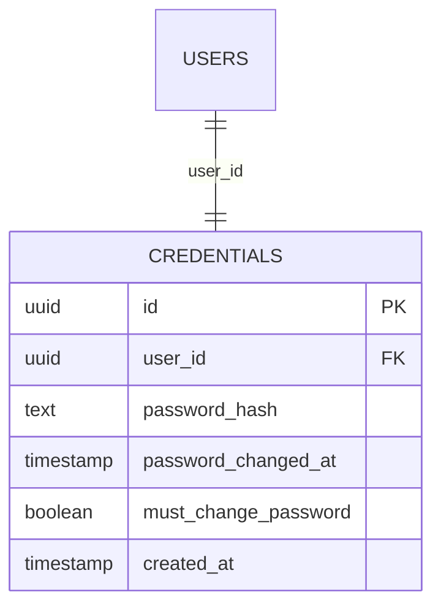

## `users` — perfis, contas e extensão do analista

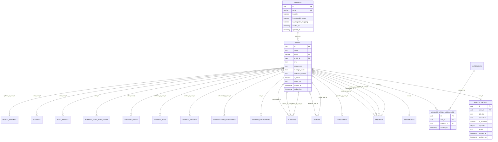

## `requests` — ciclo da solicitação e conteúdo

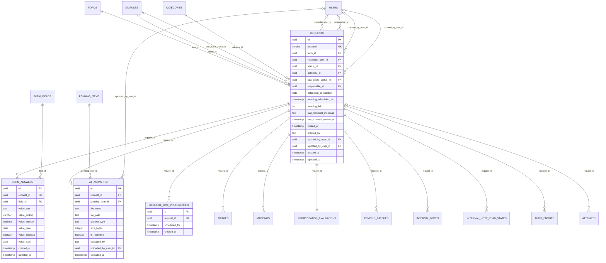

## `triage` — triagem append-only

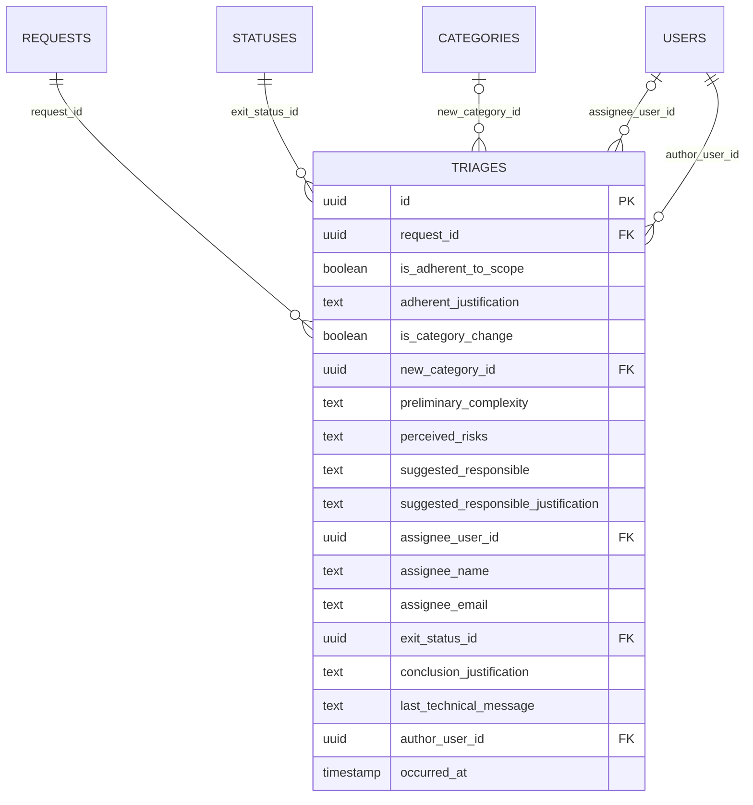

## `mapping` — sessão de mapeamento

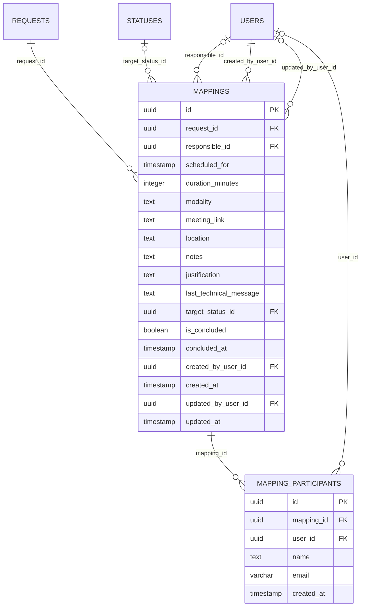

## `prioritization` — critérios, faixas e avaliação corrente

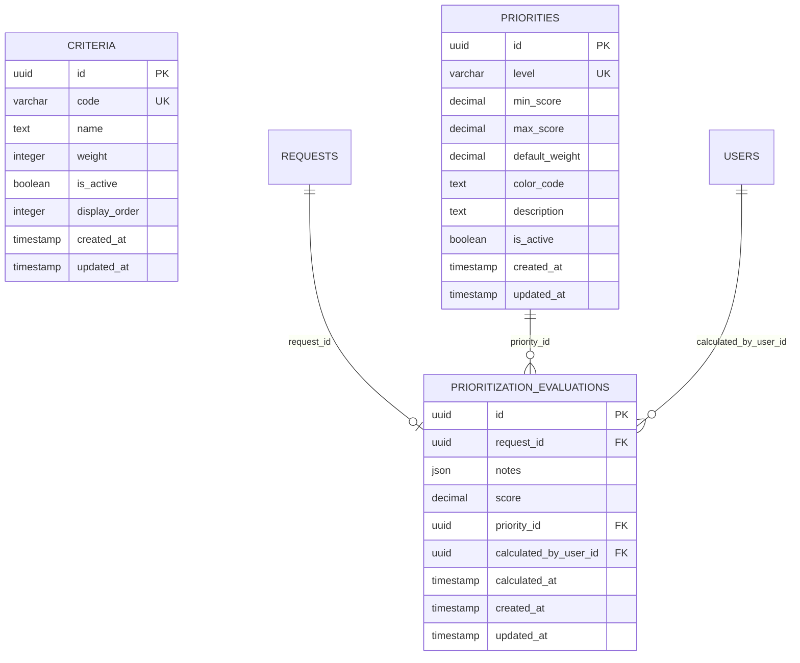

## `pending-items` — lote e itens de pendência

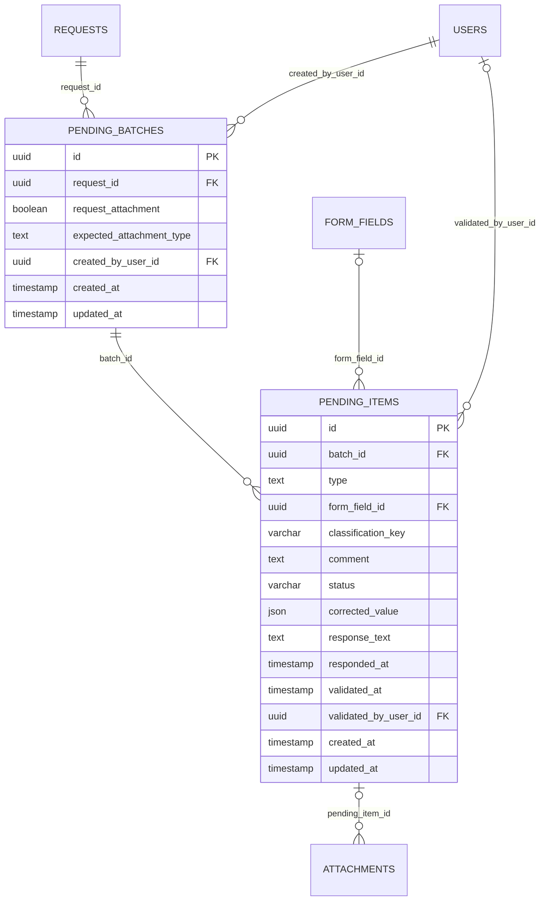

## `internal-notes` — notas internas e marcas de leitura

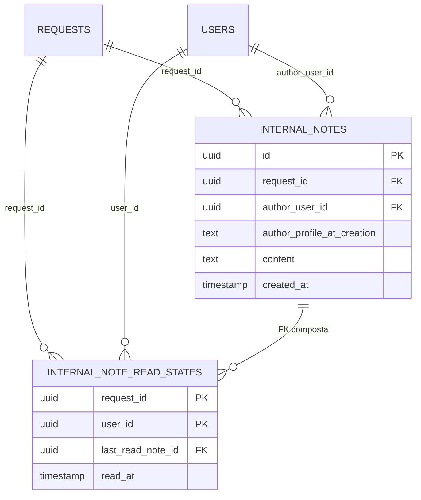

## `audit` — trilha de alterações e de recusas

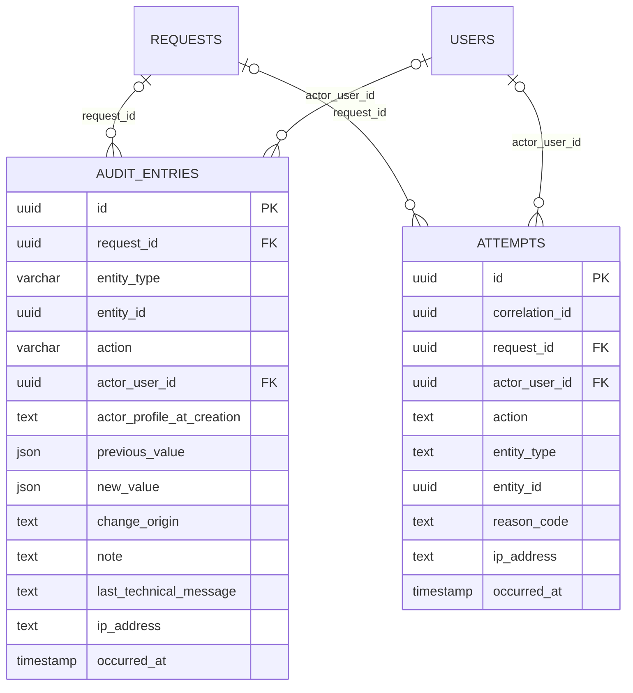

## `portal-config` — configuração do portal

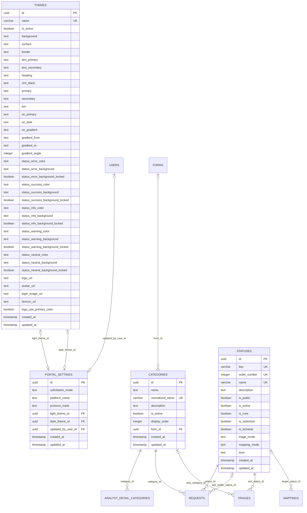

## `forms` — catálogo de formulários

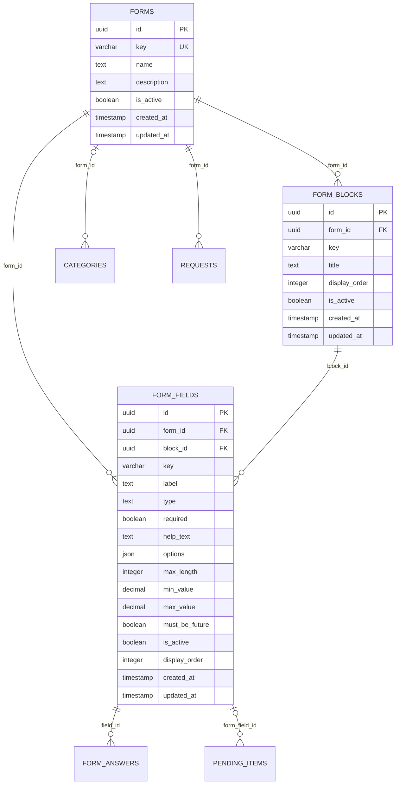

## `platform` — infraestrutura

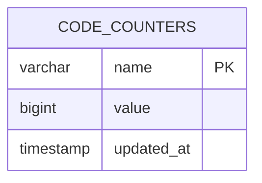

---

## Notas de leitura

- `themes` é uma linha por Aparência; `portal_settings` aponta para a clara e a escura. Os tokens são colunas explícitas, não JSON.

- `form_answers` guarda o valor em colunas tipadas; `value_lookup` é a projeção normalizada do e-mail e não conta na forma.

- `pending_batches` agrupa os itens; `pending_items` aceita **um** sujeito: `form_field_id` ou `classification_key` (constraint `ck_pending_items_subject`), ou nenhum, no caso de observação.

- `internal_note_read_states` tem PK composta (`request_id`, `user_id`) e FK composta (`request_id`, `last_read_note_id`) → `internal_notes` (`request_id`, `id`).

- `audit_entries` e `attempts` apontam para qualquer entidade por `entity_type` + `entity_id`; a referência é polimórfica, sem FK. `attempts.correlation_id` é a requisição HTTP, não a solicitação.
